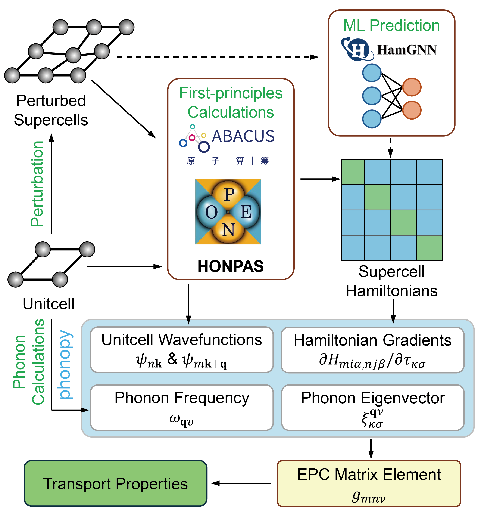

<p align="center">
  
</p>

# QTrans：A Python package for calculating Quasiparticle Transport properties.

**From electronic Hamiltonians to electron–phonon coupling and transport properties**

Explore the [online documentation](https://haozheli01.github.io/QTrans/) for installation instructions, theoretical background, input parameters, and step-by-step tutorials.


## Overview

**QTrans** is a scientific computing package for studying electron–phonon coupling (EPC) and the transport phenomena arising from quasiparticle scattering. Starting from electronic Hamiltonian and overlap matrices together with phonon data, it constructs real-space coupling gradients using finite differences and evaluates electronic, vibrational, and transport properties.

QTrans accepts electronic data from first-principles calculations and Hamiltonians predicted by machine learning methods such as [HamGNN](https://github.com/QuantumLab-ZY/HamGNN). Predicted Hamiltonians can reduce the cost of obtaining electronic data for displaced supercells, connecting machine learning electronic structure methods to materials property calculations.

### Capabilities

| Area | Calculations |
| --- | --- |
| Electronic structure | Electronic band structures and densities of states |
| Phononic properties | Phonon dispersions and densities of states |
| Electron–phonon coupling | Real-space EPC gradients and coupling matrix elements |
| Carrier transport | Electrical conductivity and carrier mobility |
| Metallic transport | Electrical resistivity |
| Superconductivity | Eliashberg spectral function and superconducting critical temperature |
| Dielectric breakdown | Intrinsic dielectric breakdown strength |

The package combines Python workflows, native C kernels with OpenMP support, and MPI parallelism for supported operations.

## Workflow

<p align="center">
  
</p>

Electronic preparation interfaces depend on the selected workflow. See the [electronic-data tutorial](docs/source/tutorials/obtain_hs.rst) for interface-specific instructions. Phonon data must describe the same reference crystal as the electronic and EPC datasets; see the [full workflow](docs/source/workflow.rst) for data requirements and unit conventions.

## Installation

### Requirements

- **Linux** with **Python 3.9 or later**; Python 3.9 is recommended for the supplied environment.
- A **C compiler with OpenMP support**, such as GCC, to build the native extension.
- An **MPI implementation**, such as MPICH or Open MPI, compatible with `mpi4py`.
- Electronic-structure software and phonon inputs appropriate to your chosen preparation workflow.

Python dependencies are declared in [pyproject.toml](pyproject.toml). The supplied [environment.yml](environment.yml) specifies a Linux x86_64 environment with Python 3.9 and CPU PyTorch 1.11, including the dependencies used for HamGNN integration.

### Install with Conda

From the repository root:

```bash
conda env create -f environment.yml
conda activate QTrans
python -m pip install -e .
```

### Install into an existing environment

With Python, an MPI runtime, and a suitable compiler already available:

```bash
python -m pip install -e .
```

Installation builds the C extension and registers `QTrans_prep` and `QTrans_run`. See the [installation guide](docs/source/installation.rst) for dependency details.


## Team

QTrans is developed by researchers at **Fudan University**. Team information follows the [project documentation](docs/source/intro/teams.rst).

### Code contributors

- **Shixu Liu** — [liusx21@m.fudan.edu.cn](mailto:liusx21@m.fudan.edu.cn)
- **Haozhe Li** — [hzli24@m.fudan.edu.cn](mailto:hzli24@m.fudan.edu.cn)
- **Dr. Yang Zhong** — [yzhong@fudan.edu.cn](mailto:yzhong@fudan.edu.cn)
- **Xingting Li** — [xtli22@m.fudan.edu.cn](mailto:xtli22@m.fudan.edu.cn)
- **Jiarui Bu** — [jrbo24@m.fudan.edu.cn](mailto:jrbo24@m.fudan.edu.cn)
- **Renyu Guo** — [ryguo24@m.fudan.edu.cn](mailto:ryguo24@m.fudan.edu.cn)

### Project leaders

- **Prof. Xingao Gong** — [xggong@fudan.edu.cn](mailto:xggong@fudan.edu.cn)
- **Prof. Hongjun Xiang** — [hxiang@fudan.edu.cn](mailto:hxiang@fudan.edu.cn)
- **Prof. Jihui Yang** — [jhyang04@fudan.edu.cn](mailto:jhyang04@fudan.edu.cn)


## License

This project is licensed under the MIT License.

Copyright (c) 2026 Yang's Group.

You are free to use, modify, and distribute this software for academic,
research, and commercial purposes, subject to the terms and conditions
of the MIT License.

See the [LICENSE](LICENSE) file for the full license text.
