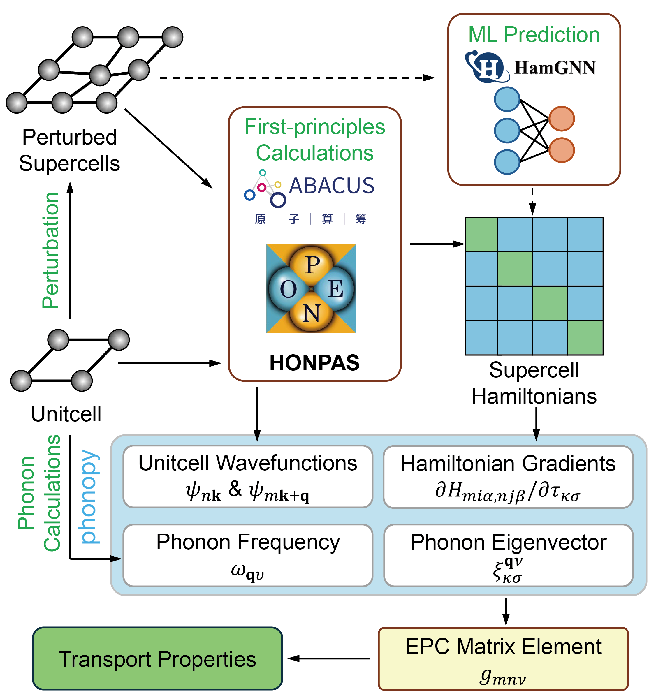

.. QTrans documentation master file

QTrans
======

A Python package for calculating **Q**\ uasiparticle **Trans**\ port properties.

News
----

* **November 21, 2026:** The first release of QTrans is now available!

.. toctree::
   :maxdepth: 1

   introduction
   installation
   theory
   workflow
   tutorials
   input_keywords
   release_notes

