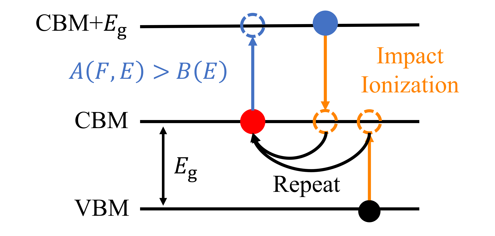

.. _theory-breakdown:

==============================
Intrinsic Dielectric Breakdown
==============================

**QTrans** estimates the intrinsic dielectric breakdown field by comparing
field-induced electron heating with energy transfer to phonons
:cite:`sunIntrinsicElectricalBreakdown2012, liuIntrinsicBreakdownStrength2025`.
This energy-balance model describes dilute conduction electrons interacting
with an equilibrium phonon bath. It uses a scalar effective mass and an
energy-averaged scattering time; it does not include defect-assisted or
thermal breakdown mechanisms.

Energy Gain from the Electric Field
-----------------------------------

For an electron with energy :math:`E` in an electric field of magnitude
:math:`F`, the model uses the energy gain rate

.. math::

    A(E,F)=\frac{e^2\tau(E)F^2}{3m^*},

where :math:`e>0` is the elementary charge and :math:`m^*>0` is the effective
electron mass. The factor of :math:`1/3` belongs to the three-dimensional
isotropic heating model used here. Both :math:`A(E,F)` and the energy loss
rate defined below have units of energy per unit time.

The energy-dependent relaxation time is defined as the reciprocal of the
average scattering rate on a constant-energy surface:

.. math::

    \frac{1}{\tau(E)}
    = \frac{1}{D(E)}\sum_\nu\int_{\mathrm{BZ}}
    \frac{d^3k}{\Omega_{\mathrm{BZ}}}
    \frac{1}{\tau_{\nu\mathbf{k}}}
    \delta(\varepsilon_{\nu\mathbf{k}}-E),

with the density of states

.. math::

    D(E)=\sum_\nu\int_{\mathrm{BZ}}\frac{d^3k}{\Omega_{\mathrm{BZ}}}
    \delta(\varepsilon_{\nu\mathbf{k}}-E).

Here, :math:`\nu` labels a conduction band, :math:`\mathbf{k}` is an electron
wave vector, and :math:`\Omega_{\mathrm{BZ}}` is the Brillouin-zone volume.
The same band selection, integration weights, and spin-counting convention
must be used in the numerator and :math:`D(E)`. This definition averages
:math:`\tau_{\nu\mathbf{k}}^{-1}` before taking its reciprocal; it is not an
arithmetic average of the state-resolved relaxation times in present version.

Electron-Phonon Scattering Rate
-------------------------------

In the dilute-carrier limit, Pauli blocking of the final conduction states
is neglected. Fermi's golden rule then gives

.. math::

    \frac{1}{\tau_{\nu\mathbf{k}}}
    ={}& \frac{2\pi}{\hbar}\sum_{\mu b}
    \int_{\mathrm{BZ}}\frac{d^3q}{\Omega_{\mathrm{BZ}}}
    |g_{\mu\nu b}(\mathbf{k},\mathbf{q})|^2 \\
    &\times\Big[
    n^0_{\mathbf{q}b}
    \delta(\varepsilon_{\nu\mathbf{k}}-\varepsilon_{\mu\mathbf{k+q}}
    +\hbar\omega_{\mathbf{q}b}) \\
    &\qquad+(n^0_{\mathbf{q}b}+1)
    \delta(\varepsilon_{\nu\mathbf{k}}-\varepsilon_{\mu\mathbf{k+q}}
    -\hbar\omega_{\mathbf{q}b})\Big].

The matrix element :math:`g_{\mu\nu b}(\mathbf{k},\mathbf{q})` couples the
initial electron state :math:`|\nu\mathbf{k}\rangle` to the final state
:math:`|\mu\mathbf{k+q}\rangle` through phonon mode :math:`(\mathbf{q},b)`.
The phonon has angular frequency :math:`\omega_{\mathbf{q}b}` and equilibrium
Bose–Einstein occupation :math:`n^0_{\mathbf{q}b}`. The terms proportional
to :math:`n^0_{\mathbf{q}b}` and :math:`n^0_{\mathbf{q}b}+1` describe phonon
absorption and emission, respectively.

Net Energy Loss to Phonons
--------------------------

The net energy loss rate is obtained by weighting each emission or absorption
process by the energy transferred to the phonon bath and averaging over
initial electron states at energy :math:`E`:

.. math::

    B(E)
    ={}& \frac{2\pi}{\hbar D(E)}\sum_{\nu\mu b}
    \int_{\mathrm{BZ}}\frac{d^3k}{\Omega_{\mathrm{BZ}}}
    \int_{\mathrm{BZ}}\frac{d^3q}{\Omega_{\mathrm{BZ}}}
    \hbar\omega_{\mathbf{q}b}|g_{\mu\nu b}(\mathbf{k},\mathbf{q})|^2 \\
    &\times\Big[
    (n^0_{\mathbf{q}b}+1)
    \delta(\varepsilon_{\nu\mathbf{k}}-\varepsilon_{\mu\mathbf{k+q}}
    -\hbar\omega_{\mathbf{q}b}) \\
    &\qquad-n^0_{\mathbf{q}b}
    \delta(\varepsilon_{\nu\mathbf{k}}-\varepsilon_{\mu\mathbf{k+q}}
    +\hbar\omega_{\mathbf{q}b})\Big]
    \delta(\varepsilon_{\nu\mathbf{k}}-E).

Emission contributes positively to :math:`B(E)`, whereas absorption contributes
negatively. Thus :math:`B(E)` is a net loss rate and can be negative where
phonon absorption dominates. In contrast, both processes contribute
positively to the total scattering rate :math:`\tau(E)^{-1}`.

Breakdown Criterion
-------------------

The von Hippel criterion :cite:`vonhippelElectricBreakdownSolid1937` requires
field-induced heating to exceed the net phonon energy loss throughout the
energy interval needed for impact ionization:

.. math::

    A(E,F)>B(E)
    \quad\text{for all }E\in[E_{\mathrm{CBM}},E_{\mathrm{CBM}}+E_{\mathrm{g}}],

where :math:`E_{\mathrm{CBM}}` is the conduction-band minimum and
:math:`E_{\mathrm{g}}` is the band gap. The upper endpoint is an approximate
impact-ionization threshold in this model; actual thresholds can depend on
the band structure and momentum conservation.

For :math:`B(E)\geq0`, balancing gain and loss gives the local threshold

.. math::

    F_{\mathrm{th}}(E)
    = \frac{\sqrt{3m^*}}{e}
    \sqrt{\frac{B(E)}{\tau(E)}}.

The breakdown field is the largest local threshold in the interval:

.. math::

    F_{\mathrm{bd}}
    = \max_{E\in[E_{\mathrm{CBM}},E_{\mathrm{CBM}}+E_{\mathrm{g}}]}
    \Big[\frac{\sqrt{3m^*}}{e}
    \sqrt{\frac{\max[B(E),0]}{\tau(E)}}\Big].

Energies with :math:`B(E)<0` impose no positive heating threshold. The maximum
marks the onset of the criterion; a field strictly above it satisfies the
strict inequality wherever the model rates are finite and
:math:`0<\tau(E)<\infty`.

.. note::

    Constant-energy averages are defined only where :math:`D(E)>0`. In
    practice, **QTrans** evaluates them on a broadened energy grid and excludes
    nonfinite field estimates and negative scattering-rate–energy-loss-rate
    products from the maximum. If no valid points remain, the code reports
    zero; this fallback does not establish a physical zero breakdown field.
    The result should be checked for convergence with respect to the
    electronic and phonon meshes, broadening, and energy-grid spacing.

.. note::

    The code measures electron energies relative to the conduction-band
    minimum and restricts the final maximum using ``fbd_exp_bandgap``. The
    sampled ``fbd_erange`` should cover the interval from zero to that gap.
    The input ``fbd_effective_mass`` is the effective mass in units of the
    free-electron mass, and the reported breakdown field is in MV/m.
