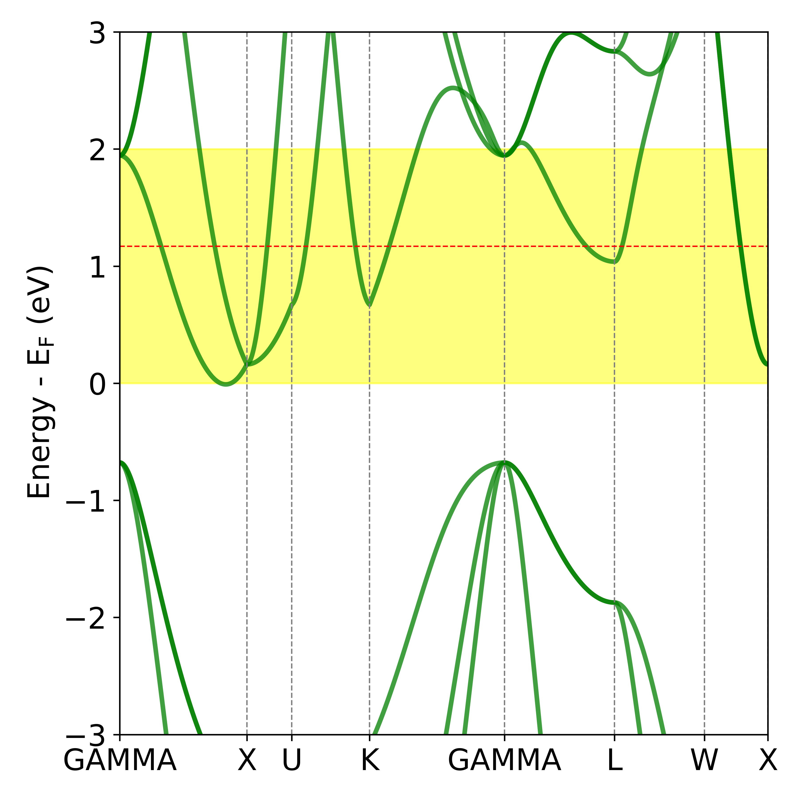

===============================
Intrinsic Dielectric Breakdown
===============================

This tutorial uses ``cal_mode: breakdown`` in **QTrans** to calculate
the intrinsic dielectric breakdown field of bulk silicon (Si).
The relevant theories are briefly introduced in the
:ref:`Theory/Intrinsic Dielectric Breakdown <theory-breakdown>` section.

.. warning::
    The following tutorials are designed for instructional purposes.
    To save computation time, the parameter settings are simplified and the results are not fully converged.

---------
Bulk Si
---------

The bulk Si tutorial is located in
``tutorials/Si/openmx/breakdown/``.
All necessary data files are available in ``tutorials/Si/openmx/data``.
Reference outputs are provided in ``tutorials/Si/openmx/breakdown/ref/``,
which can be used to compare with your own results to verify that **QTrans** is running correctly.

The directory contains ``input-sparse.yaml`` and reference outputs in
``ref/``. The input enables :ref:`read_sparse_grad_mat <cal_read_sparse_grad_mat>`
to read the sparse EPC gradients.

.. code-block:: bash

    cd tutorials/Si/openmx/breakdown/

Activate the Conda environment in which **QTrans** is installed:

.. code-block:: none

    conda activate QTrans

.. _fig-band-Si-breakdown:

   **Figure 1:**  The calculated band structures of silicon.
   The red dashed line denotes the energy level of :math:`\mathrm{CBM} + E_g` .
   The yellow region indicates the energy window considered in the calculation.

Use the sparse input to calculate the intrinsic breakdown field of Si.
We use :math:`16 \times 16 \times 16` **k**-point and **q**-point meshes.

We consider the first to fourth conduction bands by setting
:ref:`bands_indices <cal_bands_indices>` to ``'5-8'``.
Set :ref:`fbd_erange <cal_fbd_erange>` to ``[0.0, 2.0, 0.01]``
to include electron states within the energy range
:math:`\left[\text{CBM}, \text{CBM} + 2.0\;\text{eV}\right]`,
where CBM denotes the conduction band minimum.
This energy window is highlighted in yellow in :ref:`Figure 1 <fig-band-Si-breakdown>`.
The parameter :ref:`fbd_effective_mass <cal_fbd_effective_mass>` is set to ``0.96``,
in units of the free-electron mass,
and :ref:`fbd_exp_bandgap <cal_fbd_exp_bandgap>` is set to ``1.17``.
The temperature is set to room temperature via :ref:`temperature <cal_temperature>` with a value of ``300``.

Both ``smeark`` and ``smearq`` are set to 50 meV, with Gaussian broadening
(``gauss_type: 0``) and ``e_thr: 150.0`` meV. The phonon data use a
``4 x 4 x 4`` supercell, and ``epc.phonon_frequency_cutoff: 2.0`` excludes
phonon modes below 2 meV. The final field is obtained by taking the maximum
over electron energies up to ``fbd_exp_bandgap`` relative to the CBM;
``fbd_erange`` defines the wider energy grid used for the rate output.

The complete ``input-sparse.yaml`` is:

.. code-block:: yaml

    basic:
      cal_mode: 'breakdown'
      graph_data_path_uc: ../data/graph_data.npz
      nao_max: 14
      Ham_type: openmx
      outdir: './'

    advanced:
      read_sparse_grad_mat: True

    phonon:
      supercell_matrix: [[4, 0, 0], [0, 4, 0], [0, 0, 4]]
      unitcell_filename: ../data/Si-pri.vasp
      force_infos_filename: ../data/FORCE_SETS

    epc:
      grad_mat_path: ../data/grad_mat_sparse.npy
      mat_info_sc_path: ../data/mat_info_sc.npy
      cell_range_cut: [2,2,2]
      phonon_frequency_cutoff: 2.0

    transport:
      k_size: [16,16,16]
      q_size: [16,16,16]
      bands_indices: '5-8'
      temperature: 300.0
      smeark: 50.0
      smearq: 50.0
      gauss_type: 0
      e_thr: 150.0

    breakdown:
      fbd_erange: [0.0, 2.0, 0.01]
      fbd_effective_mass: 0.96
      fbd_exp_bandgap: 1.17

You can launch the **QTrans** calculation with:

.. code-block:: none

    mpirun -np 8 QTrans_run --config ./input-sparse.yaml > sparse_kq16_breakdown.out

The current ``ref/sparse_kq16_breakdown.out`` contains the following summary:

.. code-block:: text

    Smear of Summation (meV)    Max DOS (1/eV)       Breakdown Field (MV/m)
                   50.00              0.8222              100.1808
                  100.00              0.7294               89.2444
                  150.00              0.6573               81.9472
                  200.00              0.6727               85.1180
                  250.00              0.7184               91.1207
                  300.00              0.7482               95.3838
                  350.00              0.7700               98.8835
                  400.00              0.7875              102.0965
                  450.00              0.8017              105.0633
                  500.00              0.8128              107.6512

For the input energy-averaging width of 50 meV, the breakdown field is
**100.1808 MV/m**. The remaining rows vary the energy-averaging width from
100 to 500 meV while retaining the same state-resolved rates, computed with
``smearq: 50.0``. They help assess sensitivity to energy averaging and do
not replace convergence tests of the k/q meshes and scattering broadening.
The reference run ends with ``QTRANS JOB SUCCESS`` and reports no skipped
energy points at the smallest averaging width.

The program will generate a file named ``fbd_rate_nk.dat``,
which contains state-resolved scattering rates and energy loss rates.

The file ``fbd_rate_ene.dat`` contains energy-resolved quantities. For
readability, the excerpt below shows only the energy column and the first
DOS/scattering-rate/energy-loss-rate group (50 meV smearing):

.. code-block:: text

    energy(eV)  DOS(1/eV)      scatt-rate(1/ps)  eloss-rate(eV/ps)
    0.0000   5.54693678e-02   3.13931463e+00   8.89718357e-02
    0.0100   5.94034869e-02   3.26463224e+00   9.67313269e-02
    0.0200   5.96615466e-02   3.39928570e+00   1.04728565e-01

The full file has three header rows, followed by numerical data.
The first two rows contain the column titles and their corresponding units.
The third row lists the smearing parameters used for each column when integrating over electron states.
These smearing parameters range from one to ten times the value of :ref:`smeark <cal_smeark>`,
which helps verify the convergence of the integration.
Each row of the log summary gives the maximum DOS and breakdown field for
one of these energy-averaging widths. Use the first row for the width
specified by :ref:`smeark <cal_smeark>`. 
