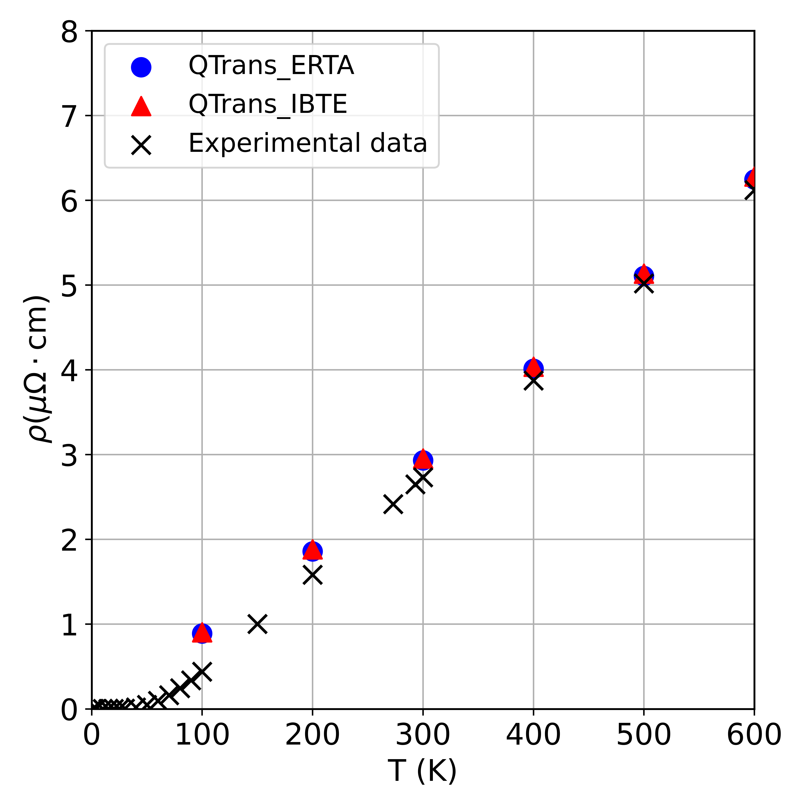
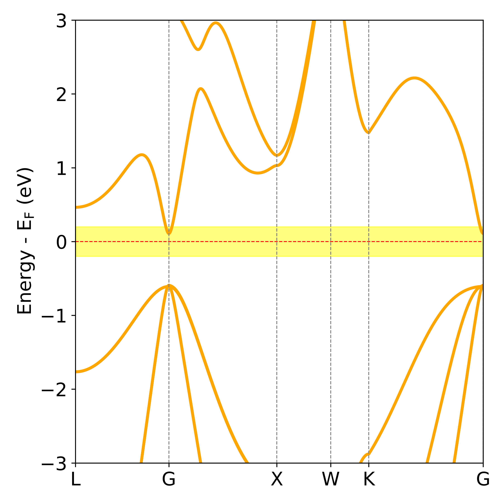
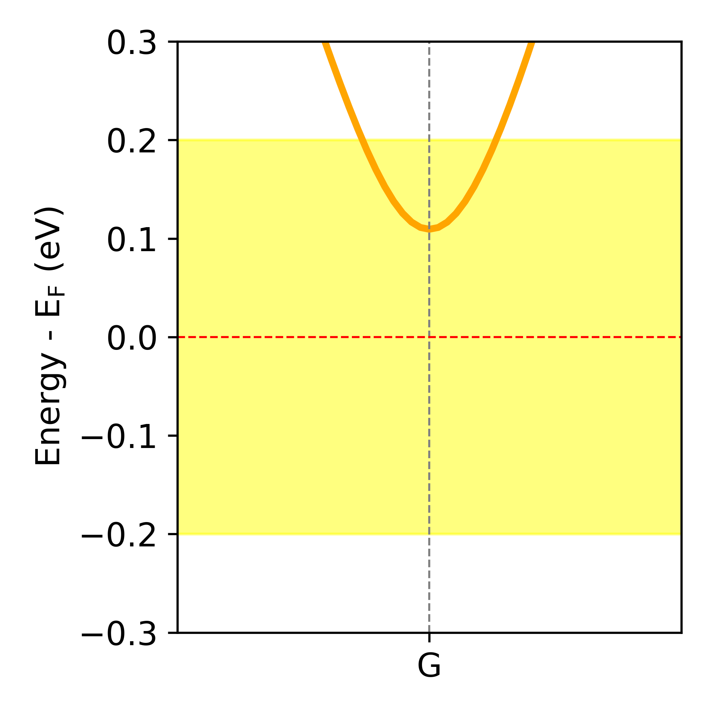

.. _tutorial-conductivity:

============================
Conductivity Calculation
============================

In this tutorial, we will show how to compute the phonon-limited electrical conductivity of nonmagnetic metal Al, 
ferromagnetic metal Fe, and intrinsic electron mobility of polar semiconductor GaAs using the 
self-energy relaxation time approximation (ERTA) and the linearised iterative Boltzmann transport
equation (IBTE) via **QTrans** using ``cal_mode: 'conductivity'``.
The relevant theories are briefly introduced in the :ref:`Conductivity <theory_conductivity>` section.

.. warning::
    The following tutorials are designed for instructional purposes. 
    To save computation time, the parameter settings are simplified and the results are not fully converged.

-----------
Bulk fcc Al
-----------

The bulk fcc aluminum tutorial is located in ``tutorials/Al/conductivity/``. 
All necessary data files are available in ``tutorials/Al/data/``. 
Reference outputs are provided in ``tutorials/Al/conductivity/ref/`` , 
which can be used to compare with your own results to verify that **QTrans** is running correctly.

Once **QTrans** is installed in your Conda environment, you can easily run the following tutorials.

The first step is enter into the directory, and there would be two yaml files: ``input-dense.yaml`` and 
``input-sparse.yaml``, and the ``ref/`` folder.
The former yaml file uses the dense gradient matrix for higher accuracy, while the latter uses a much smaller sparse 
gradient matrix for several times faster computation, with negligible accuracy loss.

.. code-block:: none

    [user]$ cd tutorials/Al/conductivity/ && ls
    input-dense.yaml  input-sparse.yaml ref/

Activate the Conda environment, then we can start the conductivity calculation of aluminum:

.. code-block:: none

    [user]$ conda activate QTrans

.. figure:: ../_static/band_Al.png
   :alt: band_Al.png
   :width: 600px
   :height: 600px
   :scale: 75 %

   **Figure 1:**  The calculated band structures of aluminum. 

1. Self-energy relaxation time approximation (ERTA)
^^^^^^^^^^^^^^^^^^^^^^^^^^^^^^^^^^^^^^^^^^^^^^^^^^^^

Here, we perform a **QTrans** calculation to calculate the conductivity of fcc aluminum on the
32x32x32 k-point and q-point grids using the self-energy relaxation time approximation (ERTA) with the 
dense gradient matrix. 

You can first check the input flags in ``input-dense.yaml`` and make sure you understand the meaning of each tag.
We consider the first six bands by setting ``bands_indices: '1-6'``, and choose an energy window with a half-width of 0.2 eV, 
using ``over_band_edge: 0.2``.
This window is highlighted as the yellow region in Figure 1. 
The temperature is set to the room temperature with ``temperature: 300.0``. 
The method used here is ERTA, which is also the default method: ``mob_level: erta``.

You can launch the **QTrans** calculation with:

.. code-block:: none

    [user]$ mpirun -np 8 QTrans_run --config ./input-dense.yaml > dense_kq32_erta.out

The calculation should take about 4 min to complete on an 8-CPU machine.
At the end of the run, you should see output like this:

.. code-block:: none

    ====================================================================================================
                                    Energy Relaxation Time Approximation
    ====================================================================================================
    Conductivity(Siemens/m)      x                y                z
        x                2.7738e+07       1.2763e-11      -1.4351e-11
        y               -1.0283e-10       2.7738e+07      -6.7449e-12
        z                2.1526e-11       4.8075e-11       2.7738e+07

This result is consistent with the symmetry of the FCC structure, where 
only the diagonal components of the conductivity tensor are non-zero.

Now, you can try to using ``input-sparse.yaml`` with ``read_sparse_grad_mat`` setting to ``True`` in the 
``advanced`` block to use the sparse gradient matrix and then compare the accuracy and runtime with 
the dense gradient matrix case:

.. code-block:: none

    [user]$ mpirun -np 8 QTrans_run --config ./input-sparse.yaml > sparse_kq32_erta.out

The calculation should take about 1.5 min to complete on an 8-CPU machine, and the output should look like:

.. code-block:: none

    ====================================================================================================
                                    Energy Relaxation Time Approximation
    ====================================================================================================
    Conductivity(Siemens/m)      x                y                z
        x                2.7607e+07      -2.3165e-10       3.6577e-11
        y               -1.1577e-10       2.7607e+07      -5.8659e-12
        z                2.4665e-11      -1.4907e-11       2.7607e+07

As you can see, the two conductivity tensors are very close, with negligible error,
while the sparse calculation runs more than twice as fast. 
In fact, as the k/q grids get denser, the speedup would become even more significant.

2. Iterative Boltzmann transport equation (IBTE)
^^^^^^^^^^^^^^^^^^^^^^^^^^^^^^^^^^^^^^^^^^^^^^^^^

You can also compute the conductivity of aluminum using the iterative Boltzmann transport equation (IBTE).
IBTE uses the same input variables as ERTA, expect setting ``mob_level: ibte``.
You can also set additional tags such as the convergence threshold ``ibte_error`` and 
the maximum number of iterations of IBTE ``ibte_cycle``
can be set accordingly.

Same with above calculations, run **QTrans** with ``input-dense.yaml``:

.. code-block:: none

    [user]$ mpirun -np 8 QTrans_run --config ./input-dense.yaml > dense_kq32_ibte.out

You should find output like this:

.. code-block:: none

    ====================================================================================================
                                    Energy Relaxation Time Approximation
    ====================================================================================================
    Conductivity(Siemens/m)      x                y                z
        x                2.7738e+07       1.2763e-11      -1.4351e-11
        y               -1.0283e-10       2.7738e+07      -6.7449e-12
        z                2.1526e-11       4.8075e-11       2.7738e+07

    ====================================================================================================
    Iteration number:    1
    ====================================================================================================
    Conductivity(Siemens/m)      x                y                z
        x                3.2856e+07      -5.3665e-10      -4.7681e-11
        y               -3.2899e-10       3.2856e+07       1.7472e-11
        z                2.3715e-11      -2.5293e-11       3.2856e+07
    Error of this iteration: 5.1188e+06
    ...
    ...
    ====================================================================================================
    Iteration number:   19
    ====================================================================================================
    Conductivity(Siemens/m)      x                y                z
        x                3.4184e+07       5.4807e-11       2.1347e-11
        y                3.9146e-10       3.4184e+07       5.3708e-11
        z                1.0835e-11       3.6164e-11       3.4184e+07
    Error of this iteration: 3.9935e-06

    ====================================================================================================
                            Converged in 19 cycles with error = 3.9935e-06
    ====================================================================================================

IBTE converged in 19 iterations, with a maximum error of :math:`3.9935\times 10^{-6}` Siemens/m for conductivity tensors. 
We can note that IBTE also output the zeroth-order solution (ERTA) in the begining.

The sparse gradient matrix gives a similar result:

.. code-block:: none

    ...
    ...
    ...
    ====================================================================================================
    Iteration number:   19
    ====================================================================================================
    Conductivity(Siemens/m)      x                y                z
        x                3.4111e+07      -1.5257e-10      -1.4315e-11
        y               -6.7400e-11       3.4111e+07       2.5473e-12
        z                3.5805e-11      -5.8336e-11       3.4111e+07
    Error of this iteration: 4.9099e-06

    ====================================================================================================
                            Converged in 19 cycles with error = 4.9099e-06
    ====================================================================================================

In this tutorial, the IBTE result (:math:`3.418\times 10^{7}`) is slightly large than that of ERTA (:math:`2.774\times 10^{7}`), 
and is more close to the experimental value of  :math:`3.659\times 10^{7}` Siemens/m :cite:`desaiAluminumRho1984`.

At convergence, the resistivity results derived from the conductivity tensors, in comparison with the 
experimental results :cite:`desaiAluminumRho1984`, are as follows:

   **Figure 2:** The converged resistivity of Al calculated with ERTA and IBTE using **QTrans**.  
   The experimental data are taken from ref :cite:`desaiAluminumRho1984`.

-----------
Bulk bcc Fe
-----------

Iron is a ferromagnetic metal, we need to consider its magnetism in the conductivity calculation.

The bulk bcc iron tutorial is located in ``tutorials/Fe/conductivity/``. 
All necessary data files are available in ``tutorials/Fe/data/``.
Reference outputs are provided in ``tutorials/Fe/conductivity/ref/`` , 
which can be used to compare with your own results to verify that **QTrans** is running correctly.

Enter into the directory, and there would be two yaml files: ``input-dense.yaml`` and 
``input-sparse.yaml`` and the ``ref/`` folder.

.. code-block:: none

    [user]$ cd tutorials/Fe/conductivity/ && ls
    input-dense.yaml  input-sparse.yaml ref/

.. figure:: ../_static/band_Fe.png
   :alt: band_Fe.png
   :width: 600px
   :height: 600px
   :scale: 75 %

   **Figure 3:**  The calculated band structures of iron. 

1. ERTA for conductivity of ferromagnetic iron
^^^^^^^^^^^^^^^^^^^^^^^^^^^^^^^^^^^^^^^^^^^^^^^^^^^^
In this tutorial, we set ``mob_level: erta`` to calculate spin-polarized conductivity on a coarse
16x16x16 k-point and q-point grids using ERTA.

By checking the input files ``input-dense.yaml`` or ``input-sparse.yaml``, you will notice that we have added 
tags related to magnetism, such as ``magnetic_type: 'collinear'`` and ``magnetic_tolerance: 0.4``. 
These tags define the magnetic properties of the material and influence the spin degeneracy in the calculations.

Here we include the sixth to tenth bands by specifying ``bands_indices: '6-10'``, and 
adopt the default energy window defined by a half-width of 0.2 eV using ``over_band_edge: 0.2``.
This window is highlighted as the yellow region in Figure 3. 
The temperature is set to the room temperature with ``temperature: 300.0``. 

Launch the **QTrans** calculation with:

.. code-block:: none

    [user]$ mpirun -np 8 QTrans_run --config ./input-dense.yaml > dense_kq16_erta.out

The calculation should take about 1 min to complete on an 8-CPU machine.
At the end of the run, you should see output like this:

.. code-block:: none

    ====================================================================================================
                                    Energy Relaxation Time Approximation
    ====================================================================================================
    Conductivity[spin-1](Siemens/m)      x                y                z
                x              1.2334e+07        1.0756e-10        2.8038e-10
                y             -9.3715e-11        1.2334e+07       -2.1940e-12
                z              1.0809e-10       -1.4355e-11        1.2334e+07
    Conductivity[spin-2](Siemens/m)      x                y                z
                x              6.2654e+06       -2.3281e-11        1.4043e-11
                y             -3.3280e-11        6.2654e+06       -1.3039e-11
                z              7.8123e-13       -1.2968e-11        6.2654e+06

Because of the ferromagnetism, there are two different spin channels of conductivity tensors: 
spin-1 is the majority spin channel, and spin-2 the minority one. The calculated conductivity of the majority spin
is several times larger than that of the minority spin, which is attributed to the spin-dependent electronic band structures
and spin-dependent scattering.

Perform the same calculation using the sparse gradient matrix:

.. code-block:: none

    [user]$ mpirun -np 8 QTrans_run --config ./input-sparse.yaml > sparse_kq16_erta.out

The calculation finishes in few seconds and the main results are shown as:

.. code-block:: none

    ====================================================================================================
                                    Energy Relaxation Time Approximation
    ====================================================================================================
    Conductivity[spin-1](Siemens/m)      x                y                z
                x              1.2324e+07        6.3898e-11       -6.7947e-11
                y             -1.4763e-10        1.2324e+07       -1.0761e-11
                z             -1.6883e-10       -2.5813e-11        1.2324e+07
    Conductivity[spin-2](Siemens/m)      x                y                z
                x              6.2759e+06       -4.1666e-13       -4.0071e-11
                y              3.3332e-12        6.2759e+06       -1.2155e-11
                z             -3.9500e-11       -1.2001e-11        6.2759e+06

---------------------------------
Polar semiconductor GaAs
---------------------------------

In this tutorial, we show how to compute the intrinsic electron
mobility of the polar semiconductor GaAs using ERTA.

Polar materials exhibit long-range electron-phonon (e-ph) interactions between 
electrons and longitudinal optical (LO) phonons.
These interactions pose challenges in achieving convergence in phonon-limited transport calculations.
To address this, **QTrans** separates the electron-phonon coupling into two parts using the method 
described in ref :cite:`zhouPolarCorrection2016` .

Here, we compute the long-range (polar) and short-range (nonpolar) contributions separately, 
using q-point importance sampling based on the Cauchy distribution. In the final step, the total 
mobility is obtained by combining the calculated scattering rates from both polar and nonpolar parts.

The GaAs tutorial is located in ``tutorials/GaAs/mobility/``. 
All necessary data files are available in ``tutorials/GaAs/data/``.
Enter into the directory, and there would be three folders corresponding to the three separate calculations:

.. code-block:: none

    [user]$ cd tutorials/GaAs/mobility/ && ls
    polar/ rmp/ total/

   **Figure 4:**  The calculated band structures of GaAs. The Fermi level here is calculated according to
   the default electron concentration :math:`1.0\times 10^{16}` :math:`\text{cm}^{-3}`.

   **Figure 5:**  The zoomed calculated band structures of GaAs, which only contain the fifteenth band.
   The Fermi level here is calculated according to
   the default electron concentration :math:`1.0\times 10^{16}` :math:`\text{cm}^{-3}`.

1. The long-range (polar) part
^^^^^^^^^^^^^^^^^^^^^^^^^^^^^^^

We first compute the long-range (polar) contribution by setting ``polar_split:'polar'`` in the
``conductivity`` block. In the input file ``input-polar.yaml``, compared to nonpolar materials, 
additional parameters are required: the Born effective charges (``BECs``) and the dielectric 
constant (``DL``), which are necessary for applying the long-range correction (LRC). 
To activate LRC, the flag ``apply_correction: True`` must also be set.

The calculation of scattering rates in polar materials is memory demanding and typically requires ultra dense
k/q-grid for convergence.
To ensure the effective convergence of the integration results on the 
q-grid, **QTrans** employs Monte Carlo integration (``MC_sampling``) with importance sampling.
Two sampling types are supported: ``'uniform'`` and ``'Cauchy'``. 
In this tutorial, we use ``MC_sampling: 'Cauchy'`` and set the 
number of q-points to ``nsamples: 10000`` to reduce computational time. The k-grid is set to 40x40x40.
Here we use the sparse gradient matrix to speedup the calculations (``read_sparse_grad_mat: True``).

.. note::
    One can increase the number of random q-points until the electron-phonon scattering rate is fully
    converged to obtain meaningful results.

We choose to use the default carrier concentration of :math:`1.0\times 10^{16}` :math:`\text{cm}^{-3}`
for elelctron by setting ``ncarrier: 10000000000000000``.
**QTrans** will automatically determine the Fermi level corresponding to the specified carrier concentration.

.. note::
    Ensure that the concentration-dependent Fermi level lies within the specified energy window.
    Otherwise, **QTrans** may yield incorrect carrier concentrations and unreliable results.

The band structures of GaAs are shown in Figure 4.
Here, we consider only the fifteenth band by specifying ``bands_indices: '[15]'``, since it is evident 
from the default energy window (``over_band_edge: 0.2``), as shown in Figure 5, that only the 
fifteenth band contributes within this range.
This simplification is therefore reasonable and also helps reduce computational time and resource usage.

Enter into the directory ``polar/``, where you will find the input file ``input-polar.yaml`` and 
the ``ref/`` folder containing reference outputs:

.. code-block:: none

    [user]$ cd polar/ && ls
    input-polar.yaml ref/

Now we are ready to launch the **QTrans** calculation with:

.. code-block:: none

    [user]$ mpirun -np 8 QTrans_run --config ./input-polar.yaml > k40q10000_polar.out

The calculation should take about 16 min to complete on an 8-CPU machine.
At the end of the run, you should see output like this:

.. code-block:: none

    ====================================================================================================
                                    Energy Relaxation Time Approximation
    ====================================================================================================
    Mobility(cm^2/V/s)           x                y                z
        x                2.6135e+02       0.0000e+00       1.0457e-14
        y                1.0457e-14       2.6135e+02      -1.0457e-14
        z               -2.0914e-14       0.0000e+00       2.6135e+02

``cal_mode: 'conductivity'`` calculation will also output a file named ``rate_nk_polar.dat``, which has 
the following format:

.. code-block:: none

    # ef = -0.15378031368506548 Ry    nc = 4.516983509585262e-07 Ry
    # ik    ibnd    weight_k    enk(Ry)    scattering_rate(Ry)
    0  0  3.125e-05  -0.14976145288278517  3.487799749747397e-05
    1  0  0.00025  -0.14309438501937577  7.162963991678631e-05

The second line defines the columns in the table: the irreducible Brillouin zone (IBZ) k-point index, 
the band index (relative to the band range ``bands_indices`` specified by the user in the input file), 
the weight of the k-point, the eigenvalue (energy), and the scattering rate — all given in atomic units.
The remaining lines list the electronic states with non-zero scattering rates, 
along with their corresponding indices and values.
This file will be used later for the calculation of total mobility.

2. The short-range (nonpolar) part
^^^^^^^^^^^^^^^^^^^^^^^^^^^^^^^^^^^^^^^

For the nonpolar part, we use the same set of tags as in the polar case,
except setting variable ``polar_split`` to ``'rmp'`` for calculation.

Enter into the directory ``rmp/``, there would be a yaml file ``input-rmp.yaml`` and 
the ``ref/`` folder containing reference outputs:

.. code-block:: none

    [user]$ cd ..
    [user]$ cd rmp/ && ls
    input-rmp.yaml ref/

Launch the **QTrans** calculation with:

.. code-block:: none

    [user]$ mpirun -np 8 QTrans_run --config ./input-rmp.yaml > k40q10000_rmp.out

The calculation should also take about 16 min to complete on an 8-CPU machine.
At the end of the run, you should see output like this:

.. code-block:: none

    ====================================================================================================
                                    Energy Relaxation Time Approximation
    ====================================================================================================
    Mobility(cm^2/V/s)           x                y                z
        x                1.0708e+03      -6.2741e-14       8.3654e-14
        y               -4.1827e-14       1.0708e+03       0.0000e+00
        z               -8.3654e-14       0.0000e+00       1.0708e+03

There is also a scattering rate file named ``rate_nk_rmp.dat``, which has the same structure as the file
``rate_nk_polar.dat``.

2. Total mobility
^^^^^^^^^^^^^^^^^^

Using the calculated scattering rates from the polar part (``rate_nk_polar.dat``) and nonpolar part (``rate_nk_rmp.dat``),
we are ready to obtain the total mobility via these two files.

At this stage, there is no need to recompute any scattering rates. Instead, we read them directly 
from the files by setting  ``polar_rate_path: '../polar/rate_nk_polar.dat'`` and ``rmp_rate_path: '../rmp/rate_nk_rmp.dat'`` 
in the ``conductivity`` block.

Enter into the directory ``total/``, there would be a yaml file named ``input-tot.yaml`` and 
the ``ref/`` folder containing reference outputs:

.. code-block:: none

    [user]$ cd ..
    [user]$ cd total/ && ls
    input-tot.yaml ref/

Launch the **QTrans** calculation with:

.. code-block:: none

    mpirun -np 8 QTrans_run --config ./input-tot.yaml > k40q10000_tot.out

The calculation should only take about few seconds to complete on an 8-CPU machine.
At the end of the run, you should get the total mobility in the output like this:

.. code-block:: none

    ====================================================================================================
                                    Energy Relaxation Time Approximation
    ====================================================================================================
    Mobility(cm^2/V/s)           x                y                z
        x                2.1007e+02      -1.5685e-14       0.0000e+00
        y                0.0000e+00       2.1007e+02      -2.0914e-14
        z               -2.0914e-14       0.0000e+00       2.1007e+02

.. note::
    
    The GaAs calculations shown here use very coarse parameters to save time for quick testing, 
    and these results are far from convergence! 

.. note::
    
    The intrinsic hole mobility can be calculated accordingly by setting ``is_hole: True``.

.. note::
    
    The mobility of polar materials can also be computed using standard k/q-grids without Monte Carlo sampling
    by ERTA or IBTE, which typically has a slow convergence with respect to number of q-points. 
    However, IBTE does not support random sampling for q-points.