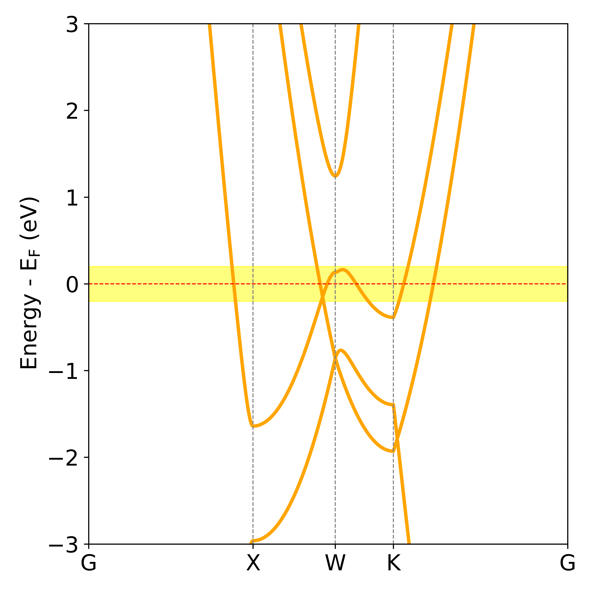
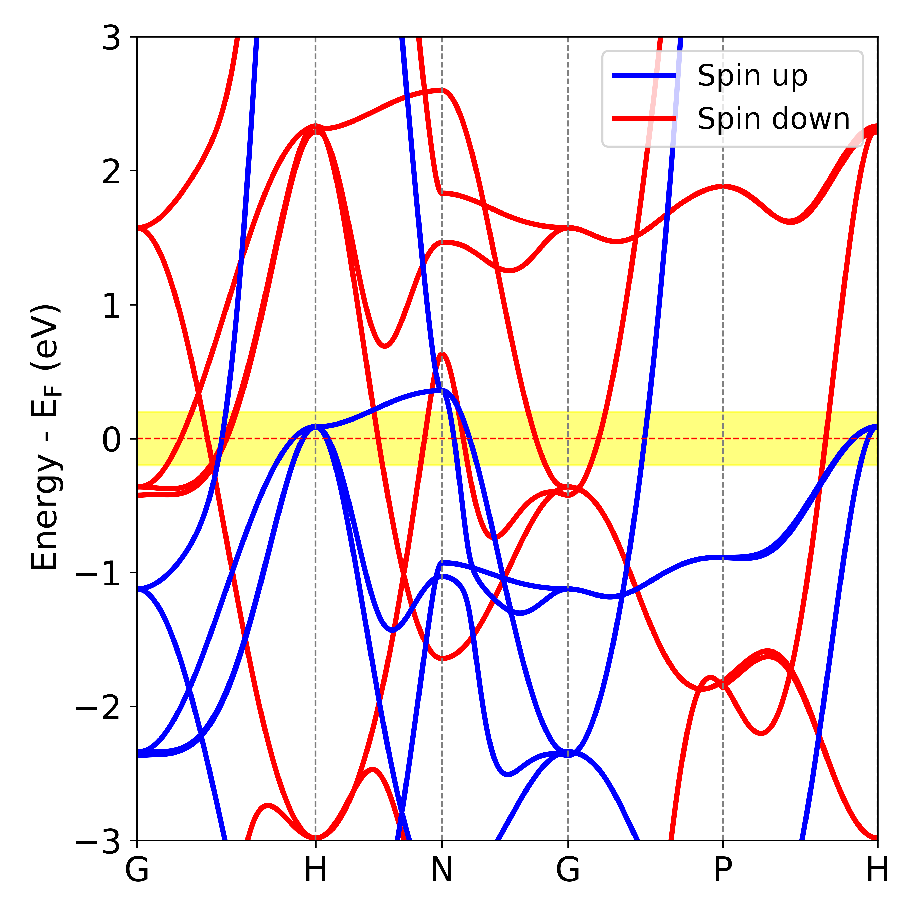

.. _tutorial-conductivity:

============================
Conductivity Calculation
============================

In this tutorial, we will show how to compute the phonon-limited electrical conductivity of nonmagnetic metal Al,
ferromagnetic metal Fe, and intrinsic electron mobility of polar semiconductor GaAs using the
self-energy relaxation time approximation (ERTA) and the linearised iterative Boltzmann transport
equation (IBTE) via **QTrans** using ``cal_mode: 'conductivity'``.
The relevant theories are briefly introduced in the :ref:`Conductivity <theory_conductivity>` section.

.. warning::
    The following tutorials are designed for instructional purposes.
    To save computation time, the parameter settings are simplified and the results are not fully converged.

-----------
Bulk fcc Al
-----------

The bulk fcc aluminum tutorial is located in ``tutorials/Al/openmx/conductivity/``.
All necessary data files are available in ``tutorials/Al/openmx/data/``.
Reference outputs are provided in ``tutorials/Al/openmx/conductivity/ref/`` ,
which can be used to compare with your own results to verify that **QTrans** is running correctly.

Once **QTrans** is installed in your Conda environment, you can easily run the following tutorials.

The calculation directory contains ``input-dense.yaml``,
``input-sparse.yaml``, and the reference outputs in ``ref/``.
The dense input reads ``grad_mat.npy``, while the sparse input reads
``grad_mat_sparse.npy`` and enables ``advanced.read_sparse_grad_mat``.
Compare their results to check the effect of sparsification for this system.

.. code-block:: none

    cd tutorials/Al/openmx/conductivity/ && ls
    input-dense.yaml  input-sparse.yaml ref/

Activate the Conda environment in which **QTrans** is installed:

.. code-block:: none

    conda activate QTrans

   **Figure 1:**  The calculated band structures of aluminum.

1. Self-energy relaxation time approximation (ERTA)
^^^^^^^^^^^^^^^^^^^^^^^^^^^^^^^^^^^^^^^^^^^^^^^^^^^^

Here, we perform a **QTrans** calculation to calculate the conductivity of fcc aluminum on the
32x32x32 k-point and q-point grids using the self-energy relaxation time approximation (ERTA) with the
dense gradient matrix.

You can first check the input flags in ``input-dense.yaml`` and make sure you understand the meaning of each tag.
We consider the first six bands by setting ``bands_indices: '1-6'``, and choose an energy window with a half-width of 0.2 eV,
using ``over_band_edge: 0.2``.
This window is highlighted as the yellow region in Figure 1.
The temperature is set to the room temperature with ``temperature: 300.0``.
The method used here is ERTA, which is also the default method: ``mob_level: erta``.

The complete ``input-dense.yaml`` is:

.. code-block:: yaml

    basic:
      cal_mode: 'conductivity'
      graph_data_path_uc: ../data/graph_data.npz
      nao_max: 14
      Ham_type: openmx
      outdir: './'

    phonon:
      supercell_matrix: [[3, 0, 0], [0, 3, 0], [0, 0, 3]]
      unitcell_filename: ../data/Al-pri.vasp
      force_infos_filename: ../data/FORCE_SETS

    epc:
      grad_mat_path: ../data/grad_mat.npy
      mat_info_sc_path: ../data/mat_info_sc.npy
      cell_range_cut: [2,2,2]
      phonon_frequency_cutoff: 0.5

    transport:
      k_size: [32,32,32]
      q_size: [32,32,32]
      bands_indices: '1-6'
      temperature: 300.0
      smeark: 40
      smearq: 40
      gauss_type: -99
      e_thr: 120

    conductivity:
      mob_level: erta
      over_band_edge: 0.2
      ibte_error: 0.00001
      ibte_cycle: 250

You can launch the **QTrans** calculation with:

.. code-block:: none

    mpirun -np 8 QTrans_run --config ./input-dense.yaml > dense_kq32_erta.out

At the end of the run, you should see output like this:

.. code-block:: text

    Conductivity(Siemens/m)           x                y                z
           x                2.7448e+07      -5.3200e-10       2.8235e-11
           y               -1.5477e-11       2.7448e+07      -4.4361e-11
           z               -4.0703e-11       1.6774e-11       2.7448e+07

This result is consistent with the symmetry of the FCC structure, where
only the diagonal components of the conductivity tensor are non-zero.

The complete ``input-sparse.yaml`` is:

.. code-block:: yaml

    basic:
      cal_mode: 'conductivity'
      graph_data_path_uc: ../data/graph_data.npz
      nao_max: 14
      Ham_type: openmx
      outdir: './'

    advanced:
      read_sparse_grad_mat: True

    phonon:
      supercell_matrix: [[3.0, 0.0, 0.0], [0, 3, 0], [0, 0, 3]]
      unitcell_filename: ../data/Al-pri.vasp
      force_infos_filename: ../data/FORCE_SETS

    epc:
      grad_mat_path: ../data/grad_mat_sparse.npy
      mat_info_sc_path: ../data/mat_info_sc.npy
      cell_range_cut: [2,2,2]
      phonon_frequency_cutoff: 0.5

    transport:
      k_size: [32,32,32]
      q_size: [32,32,32]
      bands_indices: '1-6'
      temperature: 300.0
      smeark: 40
      smearq: 40
      gauss_type: -99
      e_thr: 120

    conductivity:
      mob_level: erta
      over_band_edge: 0.2
      ibte_error: 0.00001
      ibte_cycle: 250

You can also use ``input-sparse.yaml`` with ``read_sparse_grad_mat`` setting to ``True`` in the
``advanced`` block to use the sparse gradient matrix and then compare the accuracy and runtime with
the dense gradient matrix case:

.. code-block:: none

    mpirun -np 8 QTrans_run --config ./input-sparse.yaml > sparse_kq32_erta.out

.. code-block:: text

    Conductivity(Siemens/m)           x                y                z
           x                2.7459e+07      -2.2723e-10       1.7939e-12
           y               -1.1716e-10       2.7459e+07      -9.3805e-12
           z               -2.3320e-11       1.0818e-11       2.7459e+07

The diagonal components agree within approximately 0.04% for this example.
Runtime depends on the gradient sparsity, hardware, and parallel configuration.

2. Iterative Boltzmann transport equation (IBTE)
^^^^^^^^^^^^^^^^^^^^^^^^^^^^^^^^^^^^^^^^^^^^^^^^^

You can also compute the conductivity of aluminum using the iterative Boltzmann transport equation (IBTE).
IBTE uses the same input variables as ERTA, except for setting ``mob_level: ibte``.
Set ``ibte_error`` for the convergence threshold and ``ibte_cycle`` for
the maximum number of iterations.

Both supplied OpenMX Al inputs select ERTA. Copy each input and set
``conductivity.mob_level: ibte`` before running IBTE. For example, save
the following complete configuration as ``input-dense-ibte.yaml``:

.. code-block:: yaml

    basic:
      cal_mode: 'conductivity'
      graph_data_path_uc: ../data/graph_data.npz
      nao_max: 14
      Ham_type: openmx
      outdir: './'

    phonon:
      supercell_matrix: [[3, 0, 0], [0, 3, 0], [0, 0, 3]]
      unitcell_filename: ../data/Al-pri.vasp
      force_infos_filename: ../data/FORCE_SETS

    epc:
      grad_mat_path: ../data/grad_mat.npy
      mat_info_sc_path: ../data/mat_info_sc.npy
      cell_range_cut: [2,2,2]
      phonon_frequency_cutoff: 0.5

    transport:
      k_size: [32,32,32]
      q_size: [32,32,32]
      bands_indices: '1-6'
      temperature: 300.0
      smeark: 40
      smearq: 40
      gauss_type: -99
      e_thr: 120

    conductivity:
      mob_level: ibte
      over_band_edge: 0.2
      ibte_error: 0.00001
      ibte_cycle: 250

Run **QTrans** with:

.. code-block:: none

    mpirun -np 8 QTrans_run --config ./input-dense-ibte.yaml > dense_kq32_ibte.out

You should find output like this:

.. code-block:: text

    ====================================================================================================
    Iteration number:   19
    ====================================================================================================
    Conductivity(Siemens/m)           x                y                z
           x                3.4041e+07      -7.5180e-10      -5.8462e-11
           y               -2.9355e-10       3.4041e+07       1.6475e-11
           z               -6.0094e-12       4.4908e-11       3.4041e+07

    Converged in 19 cycles with error = 5.2005e-06

IBTE converged in 19 iterations, with a maximum error of :math:`5.2005\times 10^{-6}` Siemens/m for conductivity tensors.
IBTE also reports the initial ERTA solution before iteration.

For the sparse IBTE run, save the following as ``input-sparse-ibte.yaml``:

.. code-block:: yaml

    basic:
      cal_mode: 'conductivity'
      graph_data_path_uc: ../data/graph_data.npz
      nao_max: 14
      Ham_type: openmx
      outdir: './'

    advanced:
      read_sparse_grad_mat: True

    phonon:
      supercell_matrix: [[3.0, 0.0, 0.0], [0, 3, 0], [0, 0, 3]]
      unitcell_filename: ../data/Al-pri.vasp
      force_infos_filename: ../data/FORCE_SETS

    epc:
      grad_mat_path: ../data/grad_mat_sparse.npy
      mat_info_sc_path: ../data/mat_info_sc.npy
      cell_range_cut: [2,2,2]
      phonon_frequency_cutoff: 0.5

    transport:
      k_size: [32,32,32]
      q_size: [32,32,32]
      bands_indices: '1-6'
      temperature: 300.0
      smeark: 40
      smearq: 40
      gauss_type: -99
      e_thr: 120

    conductivity:
      mob_level: ibte
      over_band_edge: 0.2
      ibte_error: 0.00001
      ibte_cycle: 250

.. code-block:: bash

    mpirun -np 8 QTrans_run --config input-sparse-ibte.yaml > sparse_kq32_ibte.out

The reference result is:

.. code-block:: text

    ====================================================================================================
    Iteration number:   19
    ====================================================================================================
    Conductivity(Siemens/m)           x                y                z
           x                3.4054e+07       4.1844e-10       3.7841e-11
           y                1.7484e-10       3.4054e+07      -1.5106e-11
           z                4.4490e-12      -2.9681e-11       3.4054e+07

    Converged in 19 cycles with error = 5.2080e-06

In this tutorial, the IBTE result (:math:`3.4041\times 10^{7}`) is larger than that of ERTA (:math:`2.7448\times 10^{7}`),
and is closer to the experimental value of  :math:`3.659\times 10^{7}` Siemens/m :cite:`desaiAluminumRho1984`.

At convergence, the resistivity results derived from the conductivity tensors, in comparison with the
experimental results :cite:`desaiAluminumRho1984`, are as follows:

.. figure:: ../_static/conductivity_Al.png
   :alt: conductivity_Al.png
   :width: 600px
   :height: 600px
   :scale: 75 %

   **Figure 2:** The converged resistivity of Al calculated with ERTA and IBTE using **QTrans**.
   The experimental data are taken from ref :cite:`desaiAluminumRho1984`.

3. IBTE for QTrans + ABACUS
^^^^^^^^^^^^^^^^^^^^^^^^^^^^^^^^^^^^^^^^^^^^^^^^^^^^^^^^^^^^^^

The ABACUS example is in ``tutorials/Al/abacus/conductivity/``. It reads
ABACUS data from ``../data/`` and uses ``nao_max: 40`` and bands 5--7.
Unlike the supplied OpenMX inputs, it already selects ``mob_level: ibte``.
The complete ``input-sparse.yaml`` is:

.. code-block:: yaml

    basic:
      cal_mode: 'conductivity'
      graph_data_path_uc: ../data/graph_data.npz
      nao_max: 40
      Ham_type: abacus
      outdir: './'

    advanced:
      read_sparse_grad_mat: True

    phonon:
      supercell_matrix: [[3.0, 0.0, 0.0], [0, 3, 0], [0, 0, 3]]
      unitcell_filename: ../data/Al-pri.vasp
      force_infos_filename: ../data/FORCE_SETS

    epc:
      grad_mat_path: ../data/grad_mat_sparse.npy
      mat_info_sc_path: ../data/mat_info_sc.npy
      cell_range_cut: [2,2,2]
      phonon_frequency_cutoff: 0.5

    transport:
      k_size: [32,32,32]
      q_size: [32,32,32]
      bands_indices: '5-7'
      temperature: 300.0
      smeark: 40
      smearq: 40
      gauss_type: -99
      e_thr: 120

    conductivity:
      mob_level: ibte
      over_band_edge: 0.2
      ibte_error: 0.00001
      ibte_cycle: 250

From the tutorial repository root, run:

.. code-block:: bash

    cd tutorials/Al/abacus/conductivity/
    mpirun -np 8 QTrans_run --config input-sparse.yaml > sparse_kq32_ibte.out

The reference IBTE result has equal diagonal conductivity components of
:math:`5.2670 \times 10^7` S/m and converges in 20 iterations, with a reported
error of :math:`7.3239 \times 10^{-6}` S/m. The reference ERTA result is
:math:`4.1158 \times 10^7` S/m. These are results for the supplied ABACUS
data and settings; comparison with OpenMX requires consistent convergence tests.

-----------
Bulk bcc Fe
-----------

For ferromagnetic Fe, treat the two collinear spin channels separately.

The bulk bcc iron tutorial is located in ``tutorials/Fe/openmx/conductivity/``.
All necessary data files are available in ``tutorials/Fe/openmx/data/``.
Reference outputs are provided in ``tutorials/Fe/openmx/conductivity/ref/`` ,
which can be used to compare with your own results to verify that **QTrans** is running correctly.

Enter into the directory, and there would be two yaml files: ``input-dense.yaml`` and
``input-sparse.yaml`` and the ``ref/`` folder.

.. code-block:: none

    cd tutorials/Fe/openmx/conductivity/ && ls
    input-dense.yaml  input-sparse.yaml ref/

   **Figure 3:**  The calculated band structures of iron.

1. ERTA for conductivity of ferromagnetic iron
^^^^^^^^^^^^^^^^^^^^^^^^^^^^^^^^^^^^^^^^^^^^^^^^^^^^
In this tutorial, we set ``mob_level: erta`` to calculate spin-polarized conductivity on a coarse
16x16x16 k-point and q-point grids using ERTA.

By checking the input files ``input-dense.yaml`` or ``input-sparse.yaml``, you will notice that we have added
tags related to magnetism, such as ``magnetic_type: 'collinear'`` and ``magnetic_tolerance: 0.4``.
Place these tags in the ``advanced`` block. ``magnetic_type: collinear``
enables separate spin channels. The sparse input also sets
``magnetic_tolerance: 0.4`` for magnetic symmetry detection.

Here we include the sixth to tenth bands by specifying ``bands_indices: '6-10'``, and
adopt the default energy window defined by a half-width of 0.2 eV using ``over_band_edge: 0.2``.
This window is highlighted as the yellow region in Figure 3.
The temperature is set to the room temperature with ``temperature: 300.0``.

The complete ``input-dense.yaml`` is:

.. code-block:: yaml

    basic:
      cal_mode: 'conductivity'
      graph_data_path_uc: ../data/graph_data.npz
      nao_max: 14
      Ham_type: openmx
      outdir: './'

    advanced:
      magnetic_type: 'collinear'

    phonon:
      supercell_matrix: [[5.0, 0.0, 0.0], [0, 5, 0], [0, 0, 5]]
      unitcell_filename: ../data/Fe-pri.vasp
      force_infos_filename: ../data/FORCE_SETS

    epc:
      grad_mat_path: ../data/grad_mat.npy
      mat_info_sc_path: ../data/mat_info_sc.npy
      cell_range_cut: [2,2,2]
      phonon_frequency_cutoff: 0.5

    transport:
      k_size: [16,16,16]
      q_size: [16,16,16]
      bands_indices: '6-10'
      temperature: 300.0
      smeark: 25
      smearq: 25
      gauss_type: -99
      e_thr: 75

    conductivity:
      over_band_edge: 0.2
      ibte_error: 0.00001
      ibte_cycle: 250
      mob_level: erta

Launch the **QTrans** calculation with:

.. code-block:: none

    mpirun -np 8 QTrans_run --config ./input-dense.yaml > dense_kq16_erta.out

At the end of the run, you should see output like this:

.. code-block:: text

    Conductivity[spin-1](Siemens/m)      x                y                z
                x              1.2325e+07        1.3380e-10        1.4600e-10
                y             -5.1509e-11        1.2325e+07        2.4725e-10
                z              1.7946e-10       -1.5949e-10        1.2325e+07
    Conductivity[spin-2](Siemens/m)      x                y                z
                x              5.6797e+06        1.2500e-11        2.2015e-11
                y             -4.9999e-12        5.6797e+06        3.5765e-11
                z              3.7421e-11        3.7837e-11        5.6797e+06

Because of the ferromagnetism, there are two different spin channels of conductivity tensors:
spin-1 is the majority spin channel, and spin-2 the minority one. The calculated conductivity of the majority spin
is about twice that of the minority spin, which is attributed to the spin-dependent electronic band structures
and spin-dependent scattering.

The complete ``input-sparse.yaml`` is:

.. code-block:: yaml

    basic:
      cal_mode: 'conductivity'
      graph_data_path_uc: ../data/graph_data.npz
      nao_max: 14
      Ham_type: openmx
      outdir: './'

    advanced:
      read_sparse_grad_mat: True
      magnetic_type: 'collinear'
      magnetic_tolerance: 0.4

    phonon:
      supercell_matrix: [[5.0, 0.0, 0.0], [0, 5, 0], [0, 0, 5]]
      unitcell_filename: ../data/Fe-pri.vasp
      force_infos_filename: ../data/FORCE_SETS

    epc:
      grad_mat_path: ../data/grad_mat_sparse.npy
      mat_info_sc_path: ../data/mat_info_sc.npy
      cell_range_cut: [2,2,2]
      phonon_frequency_cutoff: 0.5

    transport:
      k_size: [16,16,16]
      q_size: [16,16,16]
      bands_indices: '6-10'
      temperature: 300.0
      smeark: 25
      smearq: 25
      gauss_type: -99
      e_thr: 75

    conductivity:
      over_band_edge: 0.2
      ibte_error: 0.00001
      ibte_cycle: 250
      mob_level: erta

The total conductivity is the sum of the two spin-channel tensors.

Perform the same calculation using the sparse gradient matrix:

.. code-block:: none

    mpirun -np 8 QTrans_run --config ./input-sparse.yaml > sparse_kq16_erta.out

The reference results are:

.. code-block:: text

    Conductivity[spin-1](Siemens/m)      x                y                z
                x              1.2330e+07       -1.2111e-10        8.4835e-11
                y              4.3807e-11        1.2330e+07       -3.7078e-10
                z              8.8611e-11       -7.7505e-11        1.2330e+07
    Conductivity[spin-2](Siemens/m)      x                y                z
                x              5.6874e+06        4.3488e-11       -2.9390e-11
                y              2.3697e-11        5.6874e+06        1.0818e-11
                z             -2.0312e-12        1.1302e-11        5.6874e+06

---------------------------------
Polar semiconductor GaAs
---------------------------------

In this tutorial, we show how to compute the intrinsic electron
mobility of the polar semiconductor GaAs using ERTA.

Polar materials exhibit long-range electron-phonon (e-ph) interactions between
electrons and longitudinal optical (LO) phonons.
These interactions pose challenges in achieving convergence in phonon-limited transport calculations.
To address this, **QTrans** separates the electron-phonon coupling into two parts using the method
described in ref :cite:`zhouPolarCorrection2016` .

Here, we compute the long-range (polar) and short-range (nonpolar) contributions separately,
using q-point importance sampling based on the Cauchy distribution. In the final step, the total
mobility is obtained by combining the calculated scattering rates from both polar and nonpolar parts.

The GaAs tutorial is located in ``tutorials/GaAs/openmx/mobility/``.
All necessary data files are available in ``tutorials/GaAs/openmx/data/``.
The directory contains three calculations, which should be run in order:

.. code-block:: none

    cd tutorials/GaAs/openmx/mobility/ && ls
    polar/ rmp/ total/

.. figure:: ../_static/band_GaAs.png
   :alt: band_GaAs.png
   :width: 600px
   :height: 600px
   :scale: 75 %

   **Figure 4:**  The calculated band structures of GaAs. The Fermi level here is calculated according to
   the default electron concentration :math:`1.0\times 10^{16}` :math:`\text{cm}^{-3}`.

.. figure:: ../_static/band_GaAs_zoom.png
   :alt: band_GaAs_zoom.png
   :width: 600px
   :height: 600px
   :scale: 75 %

   **Figure 5:**  The zoomed calculated band structures of GaAs, which only contain the fifteenth band.
   The Fermi level here is calculated according to
   the default electron concentration :math:`1.0\times 10^{16}` :math:`\text{cm}^{-3}`.

1. The long-range (polar) part
^^^^^^^^^^^^^^^^^^^^^^^^^^^^^^^

We first compute the long-range (polar) contribution by setting ``polar_split:'polar'`` in the
``conductivity`` block. In the input file ``input-polar.yaml``, compared to nonpolar materials,
additional parameters are required: the Born effective charges (``BECs``) and the dielectric
constant (``DL``), which are necessary for applying the long-range correction (LRC).
To activate LRC, the flag ``apply_correction: True`` must also be set.

The calculation of scattering rates in polar materials is memory demanding and typically requires ultra dense
k/q-grid for convergence.
To ensure the effective convergence of the integration results on the
q-grid, **QTrans** employs Monte Carlo integration (``MC_sampling``) with importance sampling.
Two sampling types are supported: ``'uniform'`` and ``'Cauchy'``.
In this tutorial, we use ``MC_sampling: 'Cauchy'`` and set the
number of q-points to ``nsamples: 10000`` to reduce computational time. The k-grid is set to 40x40x40.
Here we use the sparse gradient matrix to speedup the calculations (``read_sparse_grad_mat: True``).

.. note::
    One can increase the number of random q-points until the electron-phonon scattering rate is fully
    converged to obtain meaningful results.

We choose to use the default carrier concentration of :math:`1.0\times 10^{16}` :math:`\text{cm}^{-3}`
for electrons by setting ``ncarrier: 10000000000000000``.
**QTrans** will automatically determine the Fermi level corresponding to the specified carrier concentration.

.. note::
    Ensure that the concentration-dependent Fermi level lies within the specified energy window.
    Otherwise, **QTrans** may yield incorrect carrier concentrations and unreliable results.

The band structures of GaAs are shown in Figure 4.
Here, we consider only the fifteenth band by specifying ``bands_indices: [15]``, since it is evident
from the default energy window (``over_band_edge: 0.2``), as shown in Figure 5, that only the
fifteenth band contributes within this range.
This simplification is therefore reasonable and also helps reduce computational time and resource usage.

Enter ``polar/``, where you will find the input file ``input-polar.yaml`` and
the ``ref/`` folder containing reference outputs:

.. code-block:: none

    cd polar/ && ls
    input-polar.yaml ref/

The complete ``input-polar.yaml`` is:

.. code-block:: yaml

    basic:
      cal_mode: 'conductivity'
      graph_data_path_uc: ../../data/graph_data.npz
      nao_max: 19
      Ham_type: openmx
      outdir: './'

    advanced:
      read_sparse_grad_mat: True

    phonon:
      supercell_matrix: [[3.0, 0.0, 0.0], [0, 3, 0], [0, 0, 3]]
      unitcell_filename: ../../data/GaAs-pri.vasp
      force_infos_filename: ../../data/FORCE_SETS
      apply_correction: True
      BECs: [[[2.10569, 0.00000, 0.00000],[0.00000, 2.10569, 0.00000],[0.00000, 0.00000, 2.10569]],[[-2.10569, 0.00000, 0.00000],[0.00000, -2.10569, 0.00000],[0.00000, 0.00000, -2.10569]]]
      DL: [[13.355780, 0.000000, 0.000000],[0.000000, 13.355780, 0.000000],[0.000000, 0.000000, 13.355780]]

    epc:
      grad_mat_path: ../../data/grad_mat_sparse.npy
      mat_info_sc_path: ../../data/mat_info_sc.npy
      cell_range_cut: [2,2,2]
      phonon_frequency_cutoff: 2.0

    transport:
      k_size: [40,40,40]
      q_size: [40,40,40]
      bands_indices: [15]
      temperature: 300.0
      smeark: 10
      smearq: 10
      gauss_type: 0
      e_thr: 30

    conductivity:
      over_band_edge: 0.2
      ncarrier: 10000000000000000
      MC_sampling: 'Cauchy'
      polar_split: 'polar'
      nsamples: 10000

Now we are ready to launch the **QTrans** calculation with:

.. code-block:: none

    mpirun -np 8 QTrans_run --config ./input-polar.yaml > k40q10000_polar.out

At the end of the run, you should see output like this:

.. code-block:: text

    Mobility(cm^2/V/s)           x                y                z
           x                2.8416e+02      -1.5685e-14       1.0457e-14
           y               -1.0457e-14       2.8416e+02      -1.0457e-14
           z               -2.0914e-14       0.0000e+00       2.8416e+02

``cal_mode: 'conductivity'`` calculation will also output a file named ``rate_nk_polar.dat``, which has
the following format:

.. code-block:: none

    #Fermi level = -0.15378031 Hartree    Density of carrier = 4.51698351e-07
    #ik_ibz  ibnd  weight_k          enk(Hartree)      scattering_rate(Hartree)
    0        0     0.000031250000    -0.149761452883   3.4883742852896680e-05
    1        0     0.000250000000    -0.143094385019   6.5879314145324497e-05

The second line defines the columns in the table: the irreducible Brillouin zone (IBZ) k-point index,
the band index (relative to the band range ``bands_indices`` specified by the user in the input file),
the weight of the k-point, the eigenvalue (energy), and the scattering rate. The indices and weights are dimensionless;
the eigenvalues and scattering-rate energies are in Hartree.
The remaining lines list the electronic states with non-zero scattering rates,
along with their corresponding indices and values.
This file will be used later for the calculation of total mobility.

2. The short-range (nonpolar) part
^^^^^^^^^^^^^^^^^^^^^^^^^^^^^^^^^^^^^^^

For the nonpolar part, we use the same set of tags as in the polar case,
except setting variable ``polar_split`` to ``'rmp'`` for calculation.

Enter ``rmp/``, there would be a yaml file ``input-rmp.yaml`` and
the ``ref/`` folder containing reference outputs:

.. code-block:: none

    cd ..
    cd rmp/ && ls
    input-rmp.yaml ref/

Launch the **QTrans** calculation with:

The complete ``input-rmp.yaml`` is:

.. code-block:: yaml

    basic:
      cal_mode: 'conductivity'
      graph_data_path_uc: ../../data/graph_data.npz
      nao_max: 19
      Ham_type: openmx
      outdir: './'

    advanced:
      read_sparse_grad_mat: True

    phonon:
      supercell_matrix: [[3.0, 0.0, 0.0], [0, 3, 0], [0, 0, 3]]
      unitcell_filename: ../../data/GaAs-pri.vasp
      force_infos_filename: ../../data/FORCE_SETS
      apply_correction: True
      BECs: [[[2.10569, 0.00000, 0.00000],[0.00000, 2.10569, 0.00000],[0.00000, 0.00000, 2.10569]],[[-2.10569, 0.00000, 0.00000],[0.00000, -2.10569, 0.00000],[0.00000, 0.00000, -2.10569]]]
      DL: [[13.355780, 0.000000, 0.000000],[0.000000, 13.355780, 0.000000],[0.000000, 0.000000, 13.355780]]

    epc:
      grad_mat_path: ../../data/grad_mat_sparse.npy
      mat_info_sc_path: ../../data/mat_info_sc.npy
      cell_range_cut: [2,2,2]
      phonon_frequency_cutoff: 2.0

    transport:
      k_size: [40,40,40]
      q_size: [40,40,40]
      bands_indices: [15]
      temperature: 300.0
      smeark: 10
      smearq: 10
      gauss_type: 0
      e_thr: 30

    conductivity:
      over_band_edge: 0.2
      ncarrier: 10000000000000000
      MC_sampling: 'Cauchy'
      polar_split: 'rmp'
      nsamples: 10000

.. code-block:: none

    mpirun -np 8 QTrans_run --config ./input-rmp.yaml > k40q10000_rmp.out

At the end of the run, you should see output like this:

.. code-block:: text

    Mobility(cm^2/V/s)           x                y                z
           x                1.9042e+03       4.1827e-14      -8.3654e-14
           y                4.1827e-14       1.9042e+03      -8.3654e-14
           z                0.0000e+00       0.0000e+00       1.9042e+03

There is also a scattering rate file named ``rate_nk_rmp.dat``, which has the same structure as the file
``rate_nk_polar.dat``.

3. Total mobility
^^^^^^^^^^^^^^^^^^

Using the calculated scattering rates from the polar part (``rate_nk_polar.dat``) and nonpolar part (``rate_nk_rmp.dat``),
we combine the state-resolved scattering rates to obtain the total mobility.
Do not add the two scalar mobilities. Use rate files generated with matching
k meshes, band selection, temperature, carrier concentration, and energy window.

At this stage, there is no need to recompute any scattering rates. Instead, we read them directly
from the files by setting  ``polar_rate_path: '../polar/rate_nk_polar.dat'`` and ``rmp_rate_path: '../rmp/rate_nk_rmp.dat'``
in the ``conductivity`` block.

Enter ``total/``, there would be a yaml file named ``input-tot.yaml`` and
the ``ref/`` folder containing reference outputs:

.. code-block:: none

    cd ..
    cd total/ && ls
    input-tot.yaml ref/

Launch the **QTrans** calculation with:

The complete ``input-tot.yaml`` is:

.. code-block:: yaml

    basic:
      cal_mode: 'conductivity'
      graph_data_path_uc: ../../data/graph_data.npz
      nao_max: 19
      Ham_type: openmx
      outdir: './'

    advanced:
      read_sparse_grad_mat: True

    phonon:
      supercell_matrix: [[3.0, 0.0, 0.0], [0, 3, 0], [0, 0, 3]]
      unitcell_filename: ../../data/GaAs-pri.vasp
      force_infos_filename: ../../data/FORCE_SETS
      apply_correction: True
      BECs: [[[2.10569, 0.00000, 0.00000],[0.00000, 2.10569, 0.00000],[0.00000, 0.00000, 2.10569]],[[-2.10569, 0.00000, 0.00000],[0.00000, -2.10569, 0.00000],[0.00000, 0.00000, -2.10569]]]
      DL: [[13.355780, 0.000000, 0.000000],[0.000000, 13.355780, 0.000000],[0.000000, 0.000000, 13.355780]]

    epc:
      grad_mat_path: ../../data/grad_mat_sparse.npy
      mat_info_sc_path: ../../data/mat_info_sc.npy
      cell_range_cut: [3,3,3]
      phonon_frequency_cutoff: 2.0

    transport:
      k_size: [40,40,40]
      q_size: [40,40,40]
      bands_indices: [15]
      smeark: 10
      smearq: 10
      gauss_type: 0
      e_thr: 30

    conductivity:
      over_band_edge: 0.2
      ncarrier: 10000000000000000
      polar_rate_path: '../polar/rate_nk_polar.dat'
      rmp_rate_path: '../rmp/rate_nk_rmp.dat'

.. code-block:: none

    mpirun -np 8 QTrans_run --config ./input-tot.yaml > k40q10000_tot.out

At the end of the run, you should get the total mobility in the output like this:

.. code-block:: text

    Mobility(cm^2/V/s)           x                y                z
           x                2.4726e+02      -1.5685e-14       4.1827e-14
           y                1.5685e-14       2.4726e+02       0.0000e+00
           z               -4.1827e-14       0.0000e+00       2.4726e+02

.. note::

    The GaAs calculations shown here use very coarse parameters to save time for quick testing,
    and these results are far from convergence!

.. note::

    The intrinsic hole mobility can be calculated accordingly by setting ``is_hole: True``.

.. note::

    The mobility of polar materials can also be computed using standard k/q-grids without Monte Carlo sampling
    by ERTA or IBTE, which typically has a slow convergence with respect to number of q-points.
    However, IBTE does not support random sampling for q-points.

