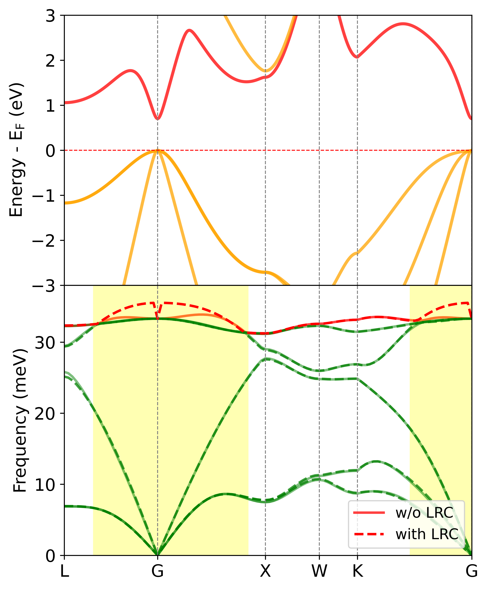

.. _tutorial-epc-path:

==========================
EPC Path Calculation
==========================

In this tutorial, we will introduce the calculation modes ``cal_mode: 'epc'`` of **QTrans** related to the
calculation and dispersion of the electron-phonon coupling (EPC) matrix elements.

-------------------------------------
EPC path of GaAs
-------------------------------------

This tutorial illustrates the calculation of the EPC matrix elements of the polar semiconductor 
GaAs using **QTrans** with and without long-range correction (LRC).

The GaAs tutorial is located in ``tutorials/GaAs/epc_disp/``. 
All necessary data files are available in ``tutorials/GaAs/data/``.
Enter into the directory, and there would be two folders corresponding to the two separate calculations:

.. code-block:: none

    [user]$ cd tutorials/GaAs/epc_disp/ && ls
    with_LRC/ without-LRC/ 

1. Without LRC
^^^^^^^^^^^^^^^^^^^

We begin by performing the calculation without considering the LRC.
Enter into the directory ``without-LRC/``, where you will find the input file ``input-epc-noLRC.yaml`` and 
the ``ref/`` folder containing reference outputs:

.. code-block:: none

    [user]$ cd without-LRC/ && ls
    input-epc-noLRC.yaml ref/

In the input file ``input-epc-noLRC.yaml``, we set ``cal_mode: 'epc'`` to compute the EPC matrix elements,
and enable the use of a sparse gradient matrix (``read_sparse_grad_mat: True``) to accelerate the calculation.
The correction is deactivated by setting ``apply_correction: False``.

Instead of computing all EPC matrix elements, we focus on a specific process: 
the EPC matrix elements :math:`\left| g_{\mu\nu b}(\mathbf{k},\mathbf{q}) \right|` between an initial electronic 
state :math:`\varepsilon_{\nu\mathbf{k}}` at a fixed wavevector
:math:`\mathbf{k}` in band :math:`\mathbf{\nu}`, and a final state :math:`\varepsilon_{\mu\mathbf{k+q}}`
in band :math:`\mathbf{\mu}`, with a phonon of branch :math:`b`,
evaluated as a function of the phonon wavevector :math:`\mathbf{q}`.

In this case, we choose the electronic state at the Gamma point in the fifteenth band (:math:`\mathbf{\nu}` = 15) as the initial state,
and choose the final state also in the fifteenth band (:math:`\mathbf{\mu}` = :math:`\mathbf{\nu}` = 15),
by specifying: ``exc_path_fix_k: [0.0,0.0,0.0]`` and ``dispersion_select_index: '15,15'``.
The q-point path L-Gamma-X-W-K-Gamma is specified manually using ``high_symmetry_points`` and ``high_symmetry_labels``.
Alternatively, one can use the automatically generated high-symmetry path.

The electronic band structures of GaAs are shown in Figure 1, where the selected band is highlighted in red. 
The band structures can be obtained using
``cal_mode: 'band'``; see the :ref:`Dispersion of Quasiparticle <tutorial-dispersion>` section
for more information.

   **Figure 1:**  (Top) The calculated electronic band structure of GaAs, with the lowest conduction 
   band highlighted in red. The Fermi level is aligned with the valence band maximum (VBM).
   (Bottom) The phonon dispersions with LRC (dotted line) and without LRC (solid line). 
   The highest optical mode is highlighted in red. The yellow region indicates where LRC has 
   a significant effect on the phonon dispersions.

Now we are ready to launch the **QTrans** calculation with:

.. code-block:: none

   [user]$  mpirun -np 8 QTrans_run --config ./input-epc-noLRC.yaml > epc-noLRC.out

The calculation is very fast and should only take about few seconds to complete.
After the calculation, **QTrans** will generate two output files: ``epc.dispersion`` and ``high_symmetry_path.dat``.
``epc.dispersion`` contains the EPC matrix element data along the q-point path with the following format:

.. code-block:: none

    # k_label: $L$ $G$ $X$ $W$ $K$ $G$
    # k_node: 0.0  0.0810640485  0.1746687514  0.2214711028  0.2545653634  0.3538481423
    0.0000000000    24.1190223762
    0.0007110881    24.1327289773
    0.0014221763    24.1462214915
    ...
    ...

The first line contains the high-symmetry k-point labels, and the second line gives the corresponding positions along the band path.
The remaining lines list the k-point distance (first column) and the EPC matrix element values (second column). 
Different phonon branches are separated by a blank line.

Using these data, we plot the calculated EPC matrix elements for the highest optical phonon branch (see Figure 1); 
the results are shown in Figure 2.

2. With LRC
^^^^^^^^^^^^^

We begin by performing the calculation with the LRC considered.
Enter into the directory ``with-LRC/``, where you will find the input file ``input-epc-LRC.yaml`` and 
the ``ref/`` folder containing reference outputs:

.. code-block:: none

    [user]$ cd ..
    [user]$ cd with-LRC/ && ls
    input-epc-LRC.yaml ref/

The calculation with LRC is similar to the one above and requires no changes except setting
``apply_correction: True``.

Launch the **QTrans** calculation with:

.. code-block:: none

    [user]$ mpirun -np 8 QTrans_run --config ./input-epc-LRC.yaml > epc-LRC.out

The calculation should take less than 1 min to complete.
Afterwards, we can plot the corrected EPC matrix elements, as shown in Figure 2.

.. figure:: ../_static/epc_band_GaAs.png
   :alt: epc_band_GaAs.png
   :width: 600px
   :height: 600px
   :scale: 75 %

   **Figure 2:**  Calculated EPC matrix elements :math:`\left| g_{\mu\nu b}(\mathbf{k},\mathbf{q}) \right|`
   along high-symmetry path at :math:`\mathbf{k}` = Gamma, :math:`\mathbf{\mu}` = :math:`\mathbf{\nu}` being
   the lowest conduction band, and :math:`b` the highest optical mode.
   The elements are averaged over degenerated states. 
   The red dashed line represents the calculation without LRC, while the green line shows 
   the calculation with LRC.The yellow region indicates where LRC has 
   a significant effect on the phonon dispersions and EPC elements.

We can see that the LRC is important for polar materials, and **QTrans** successfully describes the singular behavior of the EPC 
matrix elements as :math:`\mathbf{q} \rightarrow 0`.
