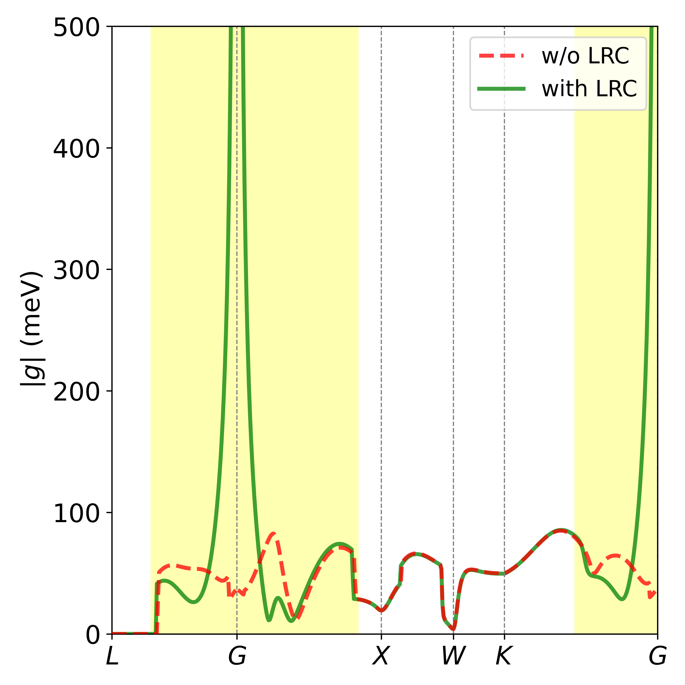

.. _tutorial-epc-path:

==========================
EPC Path Calculation
==========================

This tutorial uses ``cal_mode: epc`` in **QTrans** to calculate
electron-phonon coupling (EPC) matrix elements along a high-symmetry path.

-------------------------------------
EPC path of GaAs
-------------------------------------

This tutorial illustrates the calculation of the EPC matrix elements of the polar semiconductor
GaAs using **QTrans** with and without long-range correction (LRC).

The GaAs tutorial is located in ``tutorials/GaAs/openmx/epc-disp/``.
All necessary data files are available in ``tutorials/GaAs/openmx/data/``.
The directory contains calculations with and without LRC:

.. code-block:: none

    cd tutorials/GaAs/openmx/epc-disp/ && ls
    with-LRC/ without-LRC/

1. Without LRC
^^^^^^^^^^^^^^^^^^^

First, calculate the EPC matrix elements without LRC.
Enter ``without-LRC/``, where you will find the input file ``input-epc-noLRC.yaml`` and
the ``ref/`` folder containing reference outputs:

.. code-block:: none

    cd without-LRC/ && ls
    input-epc-noLRC.yaml ref/

In the input file ``input-epc-noLRC.yaml``, we set ``cal_mode: 'epc'`` to compute the EPC matrix elements,
and enable the use of a sparse gradient matrix (``read_sparse_grad_mat: True``) to accelerate the calculation.
The correction is deactivated by setting ``apply_correction: False``.

Instead of computing all EPC matrix elements, we focus on a specific process:
the EPC matrix elements :math:`\left| g_{\mu\nu b}(\mathbf{k},\mathbf{q}) \right|` between an initial electronic
state :math:`\varepsilon_{\nu\mathbf{k}}` at a fixed wavevector
:math:`\mathbf{k}` in band :math:`\mathbf{\nu}`, and a final state :math:`\varepsilon_{\mu\mathbf{k+q}}`
in band :math:`\mathbf{\mu}`, with a phonon of branch :math:`b`,
evaluated as a function of the phonon wavevector :math:`\mathbf{q}`.

In this case, we choose the electronic state at the Gamma point in the fifteenth band (:math:`\mathbf{\nu}` = 15) as the initial state,
and choose the final state also in the fifteenth band (:math:`\mathbf{\mu}` = :math:`\mathbf{\nu}` = 15),
by specifying: ``epc_path_fix_k: [0.0,0.0,0.0]`` and ``dispersion_select_index: '15,15'``.
The q-point path L-Gamma-X-W-K-Gamma is specified manually using ``high_symmetry_points`` and ``high_symmetry_labels``.
Alternatively, one can use the automatically generated high-symmetry path.

The electronic band structures of GaAs are shown in Figure 1, where the selected band is highlighted in red.
The band structures can be obtained using
``cal_mode: 'band'``; see the :ref:`Dispersion of Quasiparticle <tutorial-dispersion>` section
for more information.

.. figure:: ../_static/tot_band_GaAs.png
   :alt: tot_band_GaAs.png
   :width: 600px
   :height: 800px
   :scale: 75 %

   **Figure 1:**  (Top) The calculated electronic band structure of GaAs, with the lowest conduction
   band highlighted in red. The Fermi level is aligned with the valence band maximum (VBM).
   (Bottom) The phonon dispersions with LRC (dotted line) and without LRC (solid line).
   The highest optical mode is highlighted in red. The yellow region indicates where LRC has
   a significant effect on the phonon dispersions.

The complete ``input-epc-noLRC.yaml`` is:

.. code-block:: yaml

    basic:
      cal_mode: 'epc'
      graph_data_path_uc: ../../data/graph_data.npz
      nao_max: 19
      Ham_type: openmx
      outdir: './'

    advanced:
      read_sparse_grad_mat: True

    phonon:
      supercell_matrix: [[3.0, 0.0, 0.0], [0, 3, 0], [0, 0, 3]]
      unitcell_filename: ../../data/GaAs-pri.vasp
      force_infos_filename: ../../data/FORCE_SETS
      apply_correction: False
      BECs: [[[2.10569, 0.00000, 0.00000],[0.00000, 2.10569, 0.00000],[0.00000, 0.00000, 2.10569]],[[-2.10569, 0.00000, 0.00000],[0.00000, -2.10569, 0.00000],[0.00000, 0.00000, -2.10569]]]
      DL: [[13.355780, 0.000000, 0.000000],[0.000000, 13.355780, 0.000000],[0.000000, 0.000000, 13.355780]]

    epc:
      grad_mat_path: ../../data/grad_mat_sparse.npy
      mat_info_sc_path: ../../data/mat_info_sc.npy
      cell_range_cut: [3,3,3]
      q_cut: 100.0

    dispersion:
      high_symmetry_points: [[0.5, 0.5, 0.5],[0.0, 0.0, 0.0],[0.5, 0.0, 0.5],[0.5, 0.25, 0.75],[0.375, 0.375, 0.75],[0.0, 0.0, 0.0]]
      high_symmetry_labels: ['L', 'G', 'X', 'W', 'K', 'G']
      nks_path: 500
      epc_path_fix_k: [0.0, 0.0, 0.0]
      dispersion_select_index: '15,15'

Now we are ready to launch the **QTrans** calculation with:

.. code-block:: none

    mpirun -np 8 QTrans_run --config ./input-epc-noLRC.yaml > epc-noLRC.out

The main outputs are ``epc-ave.dispersion``,
``dispersions/epc-15-15.dispersion``, and ``high_symmetry_path.dat``.
The degeneracy-averaged data in ``epc-ave.dispersion`` have the following format:

.. code-block:: text

    # q_label: $L$ $G$ $X$ $W$ $K$ $G$
    # q_node: 0.0  0.0810640485  0.1746687514  0.2214711028  0.2545653634  0.3538481423
    #  iq    q_path  ibranch   frequency(meV)    |g|(meV)     Deform. pot.(eV/Ang)
        0     0.00000      1       6.8870757960       0.0035376102       0.0000772320
        0     0.00000      2       6.8870757960       0.0035376102       0.0000772320
        0     0.00000      3      25.8072060900     109.2715124525       4.6179288411
    ...

The first two lines give the high-symmetry q-point labels and path positions.
The six columns are the q-point index, distance along the path, phonon branch
index, phonon energy (meV), averaged matrix-element magnitude (meV), and
deformation potential (eV/Angstrom). Branch indices start at 1; the six
branches are listed at each q point. The band-specific file in
``dispersions/`` provides the selected band-pair dispersion.

Using these data, we plot the calculated EPC matrix elements for the highest optical phonon branch (see Figure 1);
the results are shown in Figure 2.

2. With LRC
^^^^^^^^^^^^^

Next, repeat the calculation with LRC.
Enter ``with-LRC/``, where you will find the input file ``input-epc-LRC.yaml`` and
the ``ref/`` folder containing reference outputs:

.. code-block:: none

    cd ..
    cd with-LRC/ && ls
    input-epc-LRC.yaml ref/

Enable LRC with ``phonon.apply_correction: True``. The Born effective
charges (``BECs``) and dielectric tensor (``DL``) are supplied in both
configurations, but the correction is applied only in this run.
The dipole-correction cutoff ``q_cut`` belongs in the ``epc`` block.

The complete ``input-epc-LRC.yaml`` is:

.. code-block:: yaml

    basic:
      cal_mode: 'epc'
      graph_data_path_uc: ../../data/graph_data.npz
      nao_max: 19
      Ham_type: openmx
      outdir: './'

    advanced:
      read_sparse_grad_mat: True

    phonon:
      supercell_matrix: [[3.0, 0.0, 0.0], [0, 3, 0], [0, 0, 3]]
      unitcell_filename: ../../data/GaAs-pri.vasp
      force_infos_filename: ../../data/FORCE_SETS
      apply_correction: True
      BECs: [[[2.10569, 0.00000, 0.00000],[0.00000, 2.10569, 0.00000],[0.00000, 0.00000, 2.10569]],[[-2.10569, 0.00000, 0.00000],[0.00000, -2.10569, 0.00000],[0.00000, 0.00000, -2.10569]]]
      DL: [[13.355780, 0.000000, 0.000000],[0.000000, 13.355780, 0.000000],[0.000000, 0.000000, 13.355780]]

    epc:
      grad_mat_path: ../../data/grad_mat_sparse.npy
      mat_info_sc_path: ../../data/mat_info_sc.npy
      cell_range_cut: [3,3,3]
      q_cut: 100.0

    dispersion:
      high_symmetry_points: [[0.5, 0.5, 0.5],[0.0, 0.0, 0.0],[0.5, 0.0, 0.5],[0.5, 0.25, 0.75],[0.375, 0.375, 0.75],[0.0, 0.0, 0.0]]
      high_symmetry_labels: ['L', 'G', 'X', 'W', 'K', 'G']
      nks_path: 500
      epc_path_fix_k: [0.0, 0.0, 0.0]
      dispersion_select_index: '15,15'

Launch the **QTrans** calculation with:

.. code-block:: none

    mpirun -np 8 QTrans_run --config ./input-epc-LRC.yaml > epc-LRC.out

Afterwards, we can plot the corrected EPC matrix elements, as shown in Figure 2.

   **Figure 2:**  Calculated EPC matrix elements :math:`\left| g_{\mu\nu b}(\mathbf{k},\mathbf{q}) \right|`
   along high-symmetry path at :math:`\mathbf{k}` = Gamma, :math:`\mathbf{\mu}` = :math:`\mathbf{\nu}` being
   the lowest conduction band, and :math:`b` the highest optical mode.
   The elements are averaged over degenerate states.
   The red dashed line represents the calculation without LRC, while the green line shows
   the calculation with LRC. The yellow region indicates where LRC has
   a significant effect on the phonon dispersions and EPC elements.

We can see that the LRC is important for polar materials, and **QTrans** successfully describes the singular behavior of the EPC
matrix elements as :math:`\mathbf{q} \rightarrow 0`.

When plotting the sixth (highest-frequency) branch, omit the exact Gamma
points from both the LRC and no-LRC data. The LRC value stored at Gamma is
a zero placeholder and does not represent the directional limit as
:math:`\mathbf{q} \rightarrow 0`. Mask these points with ``NaN`` or split the
curve into segments so that a line is not drawn across Gamma.
