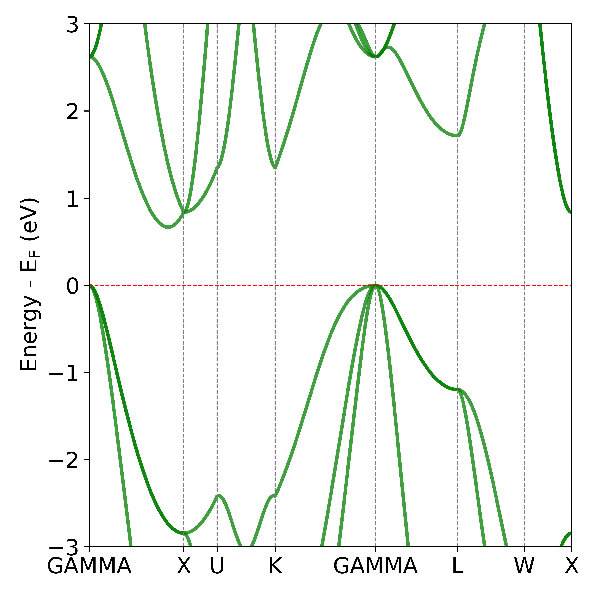
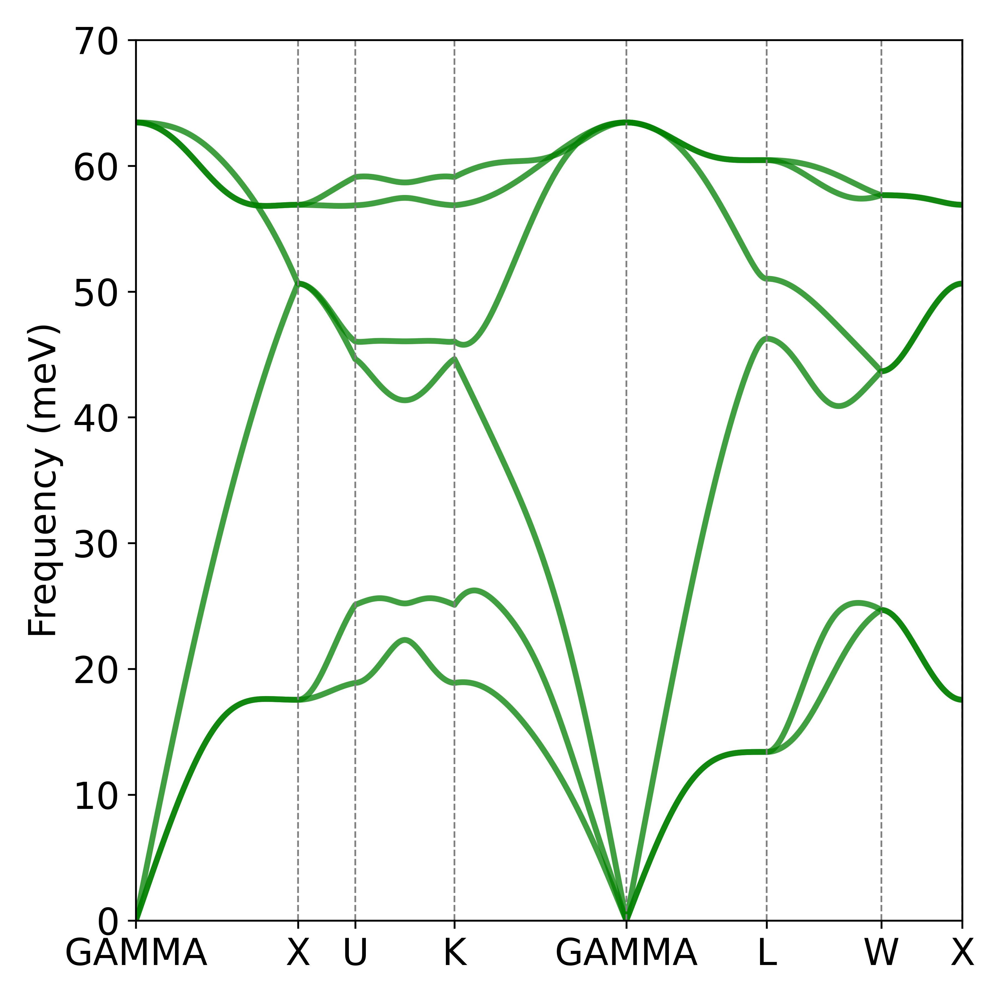

.. _tutorial-dispersion:

============================
Dispersion of Quasiparticle 
============================

In this tutorial, we introduce the calculation of quasiparticle dispersion using **QTrans**.

-------------------------------------
Electron dispersion of Si
-------------------------------------

This tutorial illustrates the calculation of the electron dispersion of the semiconductor Si .
The Si tutorial is located in ``tutorials/Si/ele_band/``. 
All necessary data files are available in ``tutorials/Si/data/``.

Enter into the directory ``tutorials/Si/ele_band/``, where you will find the input file ``input-ele.yaml`` and 
the ``ref/`` folder containing reference outputs:

.. code-block:: none

    [user]$ cd tutorials/Si/ele_band/ && ls
    input-ele.yaml ref/

In the input file ``input-ele.yaml``, we specify ``cal_mode: 'band'`` to calculate the electronic band structure.
If the tags ``high_symmetry_points`` and ``high_symmetry_labels`` are not provided, **QTrans** will automatically 
generate high-symmetry points and the corresponding k-path.
These tags can also be manually specified to customize the band path.
Here we comment out these two tags to use the automatically generated k-path.
The number of k-points along the path, ``nks_path``, is set to 1000 to ensure better resolution.

We are ready to launch the **QTrans** calculation with:

.. code-block:: none

    [user]$ mpirun -np 8 QTrans_run --config ./input-ele.yaml > ele_band.out

The calculation is very fast and should only take about few seconds to complete.
After the calculation, **QTrans** will generate two output files: ``bands.dispersion`` and ``high_symmetry_path.dat``.
``bands.dispersion`` contains the band structure data with the following format:

.. code-block:: none

    # k_label: $GAMMA$ $X$ $U$ $K$ $GAMMA$ $L$ $W$ $X$
    # k_node: 0.0000000000  0.0973729578  0.1317994977  0.1914280123  0.2947076330  0.3790350902  0.4478881698  0.4965746488
    0.0000000000    -15.0936265899
    0.0004968008    -15.0935170227
    0.0009936016    -15.0931883130
    ...
    ...

The first line contains the high-symmetry k-point labels, and the second line gives the corresponding positions along the band path.
The remaining lines list the k-point distance (first column) and the energy values (second column).
For collinear magnetic materials, the file includes three columns: the k-point distance (first column),
the spin-up energy values (second column), and the spin-down energy values (third column).
All high-symmetry k-point labels and their fractional coordinates are listed in the file ``ele_band.out``.

``high_symmetry_path.dat`` stores the fractional coordinates of each k-point in the following format:

.. code-block:: none

    # nks = 1000
    0.0000000000    0.0000000000    0.0000000000
    0.0025510204    0.0000000000    0.0025510204
    ...
    ...

One should note that the energy values for each band shown here are obtained directly from solving the Hamiltonian,
and are not shifted relative to the Fermi level. The Fermi level can be determined separately through a DOS calculation, 
see the :ref:`DOS of Quasiparticle <tutorial-dos>` section. The calculated Fermi level (VBM for semiconductors) is -3.1628 eV.
The band structure is shifted accordingly and plotted in Figure 1.

   **Figure 1:**  Calculated electron dispersion of Si. The Fermi level is aligned 
   with the valence band maximum (VBM).

-------------------------------------
Phonon dispersion of Si
-------------------------------------

This tutorial illustrates the calculation of the phonon dispersion of the semiconductor Si .
The Si tutorial is located in ``tutorials/Si/ph_band/``. 
All necessary data files are available in ``tutorials/Si/data/``.

Enter into the directory ``tutorials/Si/ph_band/``, where you will find the input file ``input-ph.yaml`` and 
the ``ref/`` folder containing reference outputs:

.. code-block:: none

    [user]$ cd tutorials/Si/ph_band/ && ls
    input-ph.yaml ref/

In the input file ``input-ph.yaml``, we specify ``cal_mode: 'phonon'`` to calculate the phonon band structures.
And we therefore need to add a ``phonon`` block with the necessary settings to compute the dynamical matrix.
Here we also use the automatically generated k-path.
The number of k-points along the path, ``nks_path``, is set to 1000 to ensure better resolution.

Launch the **QTrans** calculation with:

.. code-block:: none

    [user]$ mpirun -np 8 QTrans_run --config ./input-ph.yaml > ph_band.out

The calculation is very fast and should only take about few seconds to complete.
After the calculation, **QTrans** generates two output files: ``phbands.dispersion`` and ``high_symmetry_path.dat``,
similar to the case of electronic band dispersion. However, the unit of energy in ``phbands.dispersion`` is meV.

We can also plot the phonon dispersion of Si, as shown in Figure 2.

   **Figure 1:**  Calculated phonon dispersion of Si.

.. _electron-self-energy-modes:

Electron self-energy by phonon branch
----------------------------------------

Added 2026-10-23. Merge this fragment into a complete band-renormalization
input containing the original structure, phonons, gradients, band selection,
and integration meshes:

.. code-block:: yaml

    basic:
      cal_mode: band
      outdir: ./new_mode_run
    advanced:
      read_sparse_grad_mat: True
      magnetic_type: none
      soc_switch: False
    dispersion:
      disp_renormalize: True
      band_grid_mode: False
    phonon:
      apply_correction: False
      quadrupole_correction: False
    self-energy:
      SE_type: electron
      SE_mode_resolved: True

The new option defaults to ``False``. It saves all branches and does not alter
the initial/final band selection, phonon cutoff, occupations, or q weights.
The initial and final electron bands still share ``transport.bands_indices``;
do not reduce that selection to one initial band if other final bands are
needed. Only the nonmagnetic, no-SOC, sparse, no-long-range-correction band
path is supported for this output. Unsupported input combinations fail
explicitly, including ``band_grid_mode: True``.

The NPZ file is ``<outdir>/self_energy/electron_self_energy_modes.npz``.
Existing ``electron-se-N.dat`` and ``electron.spectrum`` files retain their
format. An existing NPZ is never overwritten; all MPI ranks report the error.
If writing fails after exclusive creation, a partial file is retained and the
run fails. Use a new output directory on retry.

.. list-table:: NPZ fields (load with ``allow_pickle=False``)
   :header-rows: 1
   :widths: 26 28 46

   * - Field
     - Shape / dtype
     - Meaning
   * - ``sigma_mode_eV``
     - ``(Nk, Nb, 3Nat, NE)``, complex128
     - Branch contributions, summed over q and final electron bands.
   * - ``sigma_total_eV``
     - ``(Nk, Nb, NE)``, complex128
     - Independently accumulated total self-energy.
   * - ``energies_eV``
     - ``(NE,)``, float64
     - Sampled energies relative to the Fermi energy.
   * - ``bare_energies_eV``
     - ``(Nk, Nb)``, float64
     - Bare band energies relative to the same Fermi energy.
   * - ``kpoints_frac``
     - ``(Nk, 3)``, float64
     - Fractional reciprocal coordinates in input path order.
   * - ``bands_1based``
     - ``(Nb,)``, int64
     - Absolute electron band numbers, starting at 1.
   * - ``branches_1based``
     - ``(3Nat,)``, int64
     - Phonon branch numbers, starting at 1.
   * - ``initial_state_mask``
     - ``(Nk, Nb)``, bool
     - Initial window selection before electronic degeneracy averaging.
   * - ``metadata_json``
     - Unicode scalar
     - Code/input identity, numerical parameters, conventions, MPI statistics.

Every branch already subtracts its zero-energy real part:

.. math::

    \widetilde\Sigma^{(\nu)}(E)
    = \Sigma^{(\nu)}(E) - \operatorname{Re}\Sigma^{(\nu)}(0).

Do not repeat this subtraction. The imaginary part retains the retarded
convention. The electronic degeneracy average uses the same groups and
``1e-6 Hartree`` tolerance for total and branch contributions. Near a window
edge, averaging can produce nonzero values where ``initial_state_mask`` is
false; do not reapply this mask after reading the file.

Branch numbers are frequency-sorted independently at every q point
(``frequency_sorted_at_each_q``), without tracking eigenvector continuity.
Within a degenerate phonon subspace, individual contributions depend on the
chosen eigenvectors; the sum over the subspace is the appropriate invariant.
The output has already summed over q and cannot reconstruct a q-resolved map.

.. code-block:: python

    import json
    import numpy as np

    with np.load("new_mode_run/self_energy/electron_self_energy_modes.npz",
                 allow_pickle=False) as data:
        np.testing.assert_allclose(
            data["sigma_mode_eV"].sum(axis=2), data["sigma_total_eV"],
            atol=1e-10, rtol=1e-8)
        metadata = json.loads(str(data["metadata_json"]))

The example tolerance is used for small regression fixtures. The spectral
function is nonlinear in self-energy: reconstruct it from the desired sum
of self-energies, rather than adding or subtracting individual spectra.
This feature alone does not identify the physical origin of a kink.

Each rank allocates ``16 * Nk * Nb * (3 * Nat) * NE`` additional bytes for
complex128 branch data. MPI reductions are chunked, but the array itself
remains resident; root also needs temporary space for unit conversion and
writing. For ``(301, 3, 36, 41)``, the primary array is about 20.3 MiB per rank.
Kernel timings and actual OpenMP thread counts are included for every rank.
The metadata temperature is in K; energy parameters are in eV. The input
hash describes canonical JSON of the original configuration dictionary,
not the bytes of the YAML file. Source and loaded-extension hashes are
recorded separately; rebuilding the extension is required after C changes.

Developer validation
^^^^^^^^^^^^^^^^^^^^

Build baseline and updated extensions in separate new directories. From the
repository root, after activating a suitable environment and compiler:

.. code-block:: bash

    set -e
    mkdir -p build
    mode_build=$(mktemp -d "$PWD/build/self_energy_modes_XXXXXXXX")
    python setup.py build_ext --build-lib "$mode_build/lib" --build-temp "$mode_build/temp"
    export MODE_TEST_NATIVE_LIB="$mode_build/lib"
    export MODE_TEST_RESULTS="$mode_build/results"
    export PYTHONDONTWRITEBYTECODE=1
    export MKL_THREADING_LAYER=SEQUENTIAL
    export OPENBLAS_NUM_THREADS=1
    OMP_NUM_THREADS=1 python tests/run_self_energy_modes.py
    OMP_NUM_THREADS=2 python tests/run_self_energy_modes.py
    OMP_NUM_THREADS=4 python tests/run_self_energy_modes.py
    OMP_NUM_THREADS=1 mpiexec -n 2 python tests/run_self_energy_modes_mpi.py
    OMP_NUM_THREADS=1 mpiexec -n 3 python tests/run_self_energy_modes_mpi.py

``MODE_TEST_BASELINE_ONLY=1`` runs the old 17-argument batch API and writes
``baseline.npz``; point ``MODE_TEST_BASELINE_FILE`` at that file when testing
the updated extension. Tests assert the loaded package/extension paths,
retain each run's JSON/logs/NPZ in a new directory, and use an independent
dense NumPy EPC/Fan reference. Fixtures cover complex waves and eigenvectors,
real CSR gradients, unequal weights, nonzero Fermi energy, 65 energy points,
degenerate window-edge states, empty MPI slices, and injected local failures.
The test fixture restores the requested OpenMP setting using PyTorch after
imports, because dependencies can change the shared runtime's thread count;
the native kernel's returned count verifies the actual threads used.

For this WSL Conda environment, first run
``source /home/jacquesrui/softwares/miniconda3/etc/profile.d/conda.sh`` and
``conda activate QTrans``; set ``CC=x86_64-conda-linux-gnu-gcc`` for the build.
``MKL_THREADING_LAYER`` is
set only for the test processes; no shell or Conda configuration is modified.
To run a complete input against a separately built extension, keep
``MODE_TEST_NATIVE_LIB`` set and select the local package explicitly:

.. code-block:: bash

    PYTHONPATH="$PWD/src${PYTHONPATH:+:$PYTHONPATH}" python -c \
      'import os; from pathlib import Path; import qtrans; qtrans.__path__.insert(0, str(Path(os.environ["MODE_TEST_NATIVE_LIB"]) / "qtrans")); from qtrans.cli import calculator_main; calculator_main()' \
      --config input.yaml

Two existing scalar-path defects are also corrected in this revision:
SOC/noncollinear and long-range sparse fallbacks now pass final energies
relative to the Fermi energy, and the scalar energy-loop index is local to
each OpenMP worker. These fixes can change previous scalar-path results,
including runs with branch output disabled. The branch-output feature does
not extend its supported configurations to those paths.
