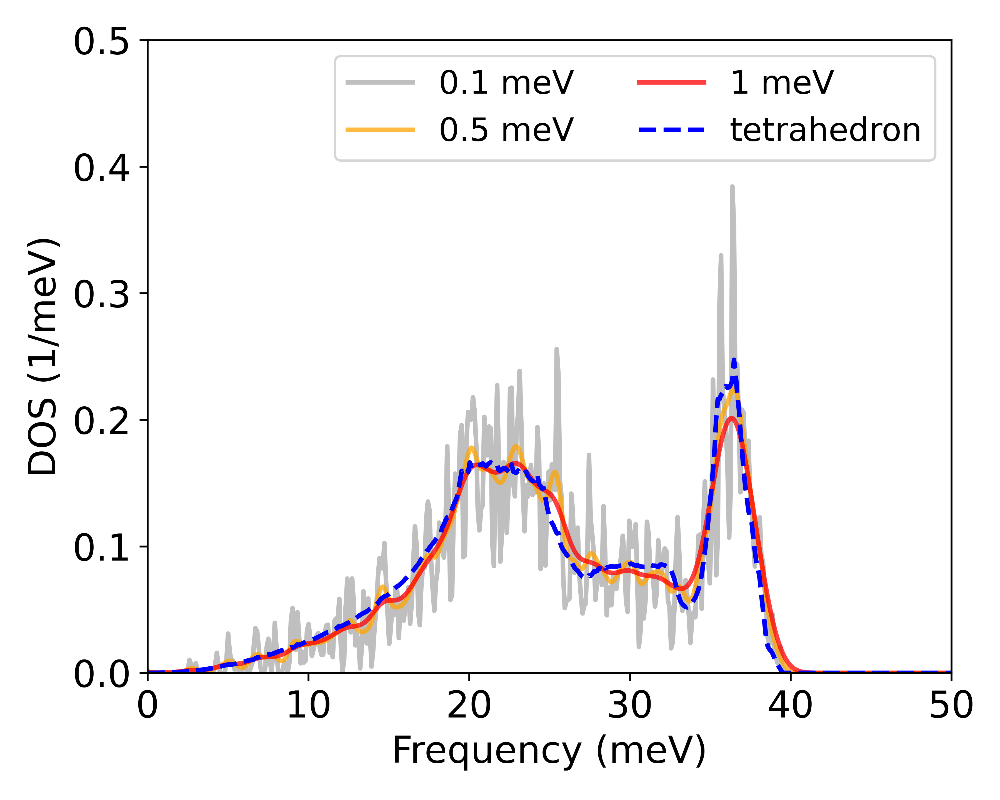

.. _tutorial-dos:

============================
DOS of Quasiparticle
============================

This tutorial uses ``cal_mode: dos`` in **QTrans** to calculate electronic
and phonon densities of states (DOS).

----------------------
Electronic DOS of GaAs
----------------------

This tutorial illustrates the calculation of the electronic density of states (DOS) for the semiconductor
GaAs using two approaches: the default smearing method and the tetrahedron method.

The GaAs tutorial is located in ``tutorials/GaAs/openmx/ele-dos/``.
All necessary data files are available in ``tutorials/GaAs/openmx/data/``.
The directory contains separate examples for the two integration methods:

.. code-block:: none

    cd tutorials/GaAs/openmx/ele-dos/ && ls
    smearing/ tetrahedron/

1. Smearing method
^^^^^^^^^^^^^^^^^^^

We begin by performing the calculation with the default smearing method.
Enter ``smearing/``, where you will find the input file ``input-smearing.yaml`` and
the ``ref/`` folder containing reference outputs:

.. code-block:: none

    cd smearing/ && ls
    input-smearing.yaml ref/

In the input file ``input-smearing.yaml``, we choose a smearing of 50 meV
(``dos_smear: 50.0``) and use a 20x20x20 k-point grid (``dos_mesh_size: [20,20,20]``).
A Gaussian kernel (``dos_gauss_type: 0``) approximates the delta function.
Set ``dos_qp: electron`` to select the electronic DOS.
The energy range for the DOS calculation is set from -10 eV to 10 eV via
``dos_erange: [-10,10]``.
Note that this energy range is defined relative to the calculated Fermi level.

The complete input file is:

.. code-block:: yaml

    basic:
      cal_mode: 'dos'
      graph_data_path_uc: ../../data/graph_data.npz
      nao_max: 19
      Ham_type: openmx
      outdir: './'

    dos:
      dos_qp: 'electron'
      dos_npoints: 500
      dos_mesh_size: [20,20,20]
      dos_smear: 50.0
      dos_gauss_type: 0
      dos_erange: [-10,10]

Run **QTrans** from this directory:

.. code-block:: none

    mpirun -np 8 QTrans_run --config ./input-smearing.yaml > k20_smearing50.out

At the end of the run, you should see output like this:

.. code-block:: none

    ######################################### DOS Calculation ##########################################
    Calculate density of states for electron.
    The system is an insulator, the VBM energy of -4.7764 eV is chosen as the reference energy.

**QTrans** automatically calculates the Fermi level when ``cal_mode: 'dos'`` is set. For metals,
it outputs the actual Fermi level, while for insulators and semiconductors, it returns the energy of the
valence band maximum (VBM).
In this case, the calculated VBM energy is -4.7764 eV.

The resulting DOS is saved in a file named ``electron_dos.dat`` in the current directory,
with the following format:

.. code-block:: none

    # Energy(eV)    DOS(1/eV)
    -1.00000000e+01 1.89442710e-11
    -9.95991984e+00 5.58089977e-15
    -9.91983968e+00 4.64104623e-19
    ...
    ...

The first column in the file represents the energy, and the second column contains the calculated DOS.
For collinear magnetic materials, the file includes three columns: the energy, spin-up DOS, and spin-down DOS.
The calculated DOS is shown in Figure 1. As can be observed, a larger smearing value results in a smoother DOS
curve, but it also leads to a loss of fine spectral details.

.. figure:: ../_static/dos_GaAs.png
   :alt: dos_GaAs.png
   :width: 600px
   :height: 480px
   :scale: 100 %

   **Figure 1:**  Calculated electronic DOS of GaAs using a 20x20x20 k-point grid. The Fermi level is aligned
   with the valence band maximum (VBM).

2. Tetrahedron method
^^^^^^^^^^^^^^^^^^^^^^

The tetrahedron method divides the Brillouin zone into small tetrahedra and performs analytical integration within each.
It enables accurate DOS calculation without relying on smearing parameters and is especially useful for capturing fine
features near the Fermi level in metallic systems.
However, the tetrahedron method requires more computational effort and is sensitive to the density and uniformity of the k-point mesh.

Next, calculate the DOS using the tetrahedron method.
Enter ``tetrahedron/``, where you will find the input file ``input-tetra.yaml`` and
the ``ref/`` folder containing reference outputs:

.. code-block:: none

    cd ..
    cd tetrahedron/ && ls
    input-tetra.yaml ref/

To activate this method, set ``tetra_integral`` to ``True`` in the ``advanced`` block.
The DOS integration itself does not use a smearing kernel. For electronic DOS,
smearing settings can still affect the reference Fermi-level calculation.
The complete input file is:

.. code-block:: yaml

    basic:
      cal_mode: 'dos'
      graph_data_path_uc: ../../data/graph_data.npz
      nao_max: 19
      Ham_type: openmx
      outdir: './'

    advanced:
      tetra_integral: True

    dos:
      dos_qp: 'electron'
      dos_npoints: 500
      dos_mesh_size: [20,20,20]
      dos_erange: [-10,10]

Run **QTrans** from this directory:

.. code-block:: none

    mpirun -np 8 QTrans_run --config ./input-tetra.yaml > k20_tetra.out 2>&1

The DOS data will be saved in a file named ``electron_dos.dat``.
The resulting DOS is plotted in Figure 1.

The DOS curve calculated using the tetrahedron method is generally smoother than raw discrete data
but differs fundamentally from smearing methods. It retains sharp features near band edges and Van Hove
singularities without the artificial broadening of a smearing kernel. Converge the mesh
for either method before comparing fine spectral features.

----------------------
Phonon DOS of Al
----------------------

This tutorial illustrates the calculation of the phonon density of states (DOS) for the metal aluminum
using two approaches: the default smearing method and the tetrahedron method.

The Al tutorial is located in ``tutorials/Al/openmx/ph-dos/``.
All necessary data files are available in ``tutorials/Al/openmx/data/``.
The directory contains separate examples for the two integration methods:

.. code-block:: none

    cd tutorials/Al/openmx/ph-dos/ && ls
    smearing/ tetrahedron/

1. Smearing method
^^^^^^^^^^^^^^^^^^^

We begin by performing the calculation with the default smearing method.
Enter ``smearing/``, where you will find the input file ``input-smearing.yaml`` and
the ``ref/`` folder containing reference outputs:

.. code-block:: none

    cd smearing/ && ls
    input-smearing.yaml ref/

Set ``dos_qp: phonon`` in ``input-smearing.yaml`` to select the phonon DOS.
You must also add a ``phonon`` block with the necessary settings to compute the dynamical matrix.
Since the phonon energy range is typically on the order of tens of meV—much smaller than that of electrons—we
need to use a smaller smearing value. We choose a smearing of 0.5 meV
(``dos_smear: 0.5``) and use a 20x20x20 q-point grid (``dos_mesh_size: [20,20,20]``) in this tutorial.
The energy range for the DOS calculation is set from 0 to 0.050 eV via
``dos_erange: [0,0.050]``. This input range is in eV, whereas the phonon
DOS output uses meV and 1/meV for the energy and DOS, respectively.

The complete input file is:

.. code-block:: yaml

    basic:
      cal_mode: 'dos'
      graph_data_path_uc: ../../data/graph_data.npz
      nao_max: 14
      Ham_type: openmx
      outdir: './'

    phonon:
      supercell_matrix: [[3.0, 0.0, 0.0], [0, 3, 0], [0, 0, 3]]
      unitcell_filename: ../../data/Al-pri.vasp
      force_infos_filename: ../../data/FORCE_SETS

    dos:
      dos_qp: 'phonon'
      dos_npoints: 500
      dos_mesh_size: [20,20,20]
      dos_smear: 0.5
      dos_gauss_type: 0
      dos_erange: [0,0.050]

Run **QTrans** from this directory:

.. code-block:: none

    mpirun -np 8 QTrans_run --config ./input-smearing.yaml > q20_smearing0.5.out

The resulting DOS is saved in a file named ``phonon_dos.dat`` in the current directory,
with the following format:

.. code-block:: none

    # Energy(meV)    DOS(1/meV)
    0.00000000e+00 4.23142188e-04
    1.00200401e-01 4.06485344e-04
    2.00400802e-01 3.60346664e-04
    ...
    ...

The first column in the file represents the phonon energy, and the second column contains the calculated DOS.
The calculated DOS is shown in Figure 2.

   **Figure 2:**  Calculated phonon DOS of Al using a 20x20x20 q-point grid.

2. Tetrahedron method
^^^^^^^^^^^^^^^^^^^^^^

Next, calculate the DOS using the tetrahedron method.
Enter ``tetrahedron/``, where you will find the input file ``input-tetra.yaml`` and
the ``ref/`` folder containing reference outputs:

.. code-block:: none

    cd ..
    cd tetrahedron/ && ls
    input-tetra.yaml ref/

To activate this method, set ``tetra_integral`` to ``True`` in the ``advanced`` block.
The phonon DOS is integrated without a smearing kernel.
The complete input file is:

.. code-block:: yaml

    basic:
      cal_mode: 'dos'
      graph_data_path_uc: ../../data/graph_data.npz
      nao_max: 14
      Ham_type: openmx
      outdir: './'

    phonon:
      supercell_matrix: [[3.0, 0.0, 0.0], [0, 3, 0], [0, 0, 3]]
      unitcell_filename: ../../data/Al-pri.vasp
      force_infos_filename: ../../data/FORCE_SETS

    advanced:
      tetra_integral: True

    dos:
      dos_qp: 'phonon'
      dos_npoints: 500
      dos_mesh_size: [20,20,20]
      dos_erange: [0,0.050]

Run **QTrans** from this directory:

.. code-block:: none

    mpirun -np 8 QTrans_run --config ./input-tetra.yaml > q20_tetra.out 2>&1

The DOS data will also be saved in a file named ``phonon_dos.dat``.
The resulting DOS is plotted in Figure 2.
