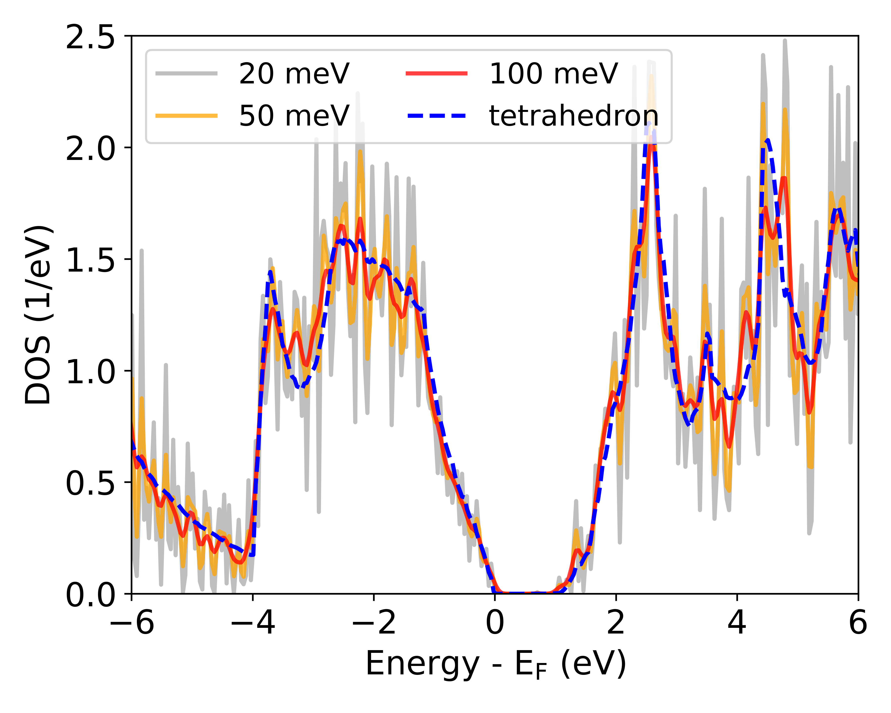

.. _tutorial-dos:

============================
DOS of Quasiparticle
============================

In this tutorial, we will introduce the calculation modes ``cal_mode: 'dos'`` of **QTrans** related to the
density of state (DOS) of quasiparticles.

----------------------
Electronic DOS of GaAs
----------------------

This tutorial illustrates the calculation of the electronic density of states (DOS) for the semiconductor 
GaAs using two approaches: the default smearing method and the more accurate tetrahedron method.

The GaAs tutorial is located in ``tutorials/GaAs/ele_dos/``. 
All necessary data files are available in ``tutorials/GaAs/data/``.
Enter into the directory, and there would be two folders corresponding to the two separate calculations:

.. code-block:: none

    [user]$ cd tutorials/GaAs/ele_dos/ && ls
    smearing/ tetrahedron/ 

1. Smearing method
^^^^^^^^^^^^^^^^^^^

We begin by performing the calculation with the default smearing method.
Enter into the directory ``smearing/``, where you will find the input file ``input-smearing.yaml`` and 
the ``ref/`` folder containing reference outputs:

.. code-block:: none

    [user]$ cd smearing/ && ls
    input-smearing.yaml ref/

In the input file ``input-smearing.yaml``, we choose a smearing of 50 meV 
(``dos_smear: 50.0``) and use a 20x20x20 k-point grid (``dos_mesh_size: [20,20,20]``). 
And we use the derivative of the Methfessel-Paxton polynomial (``dos_gauss_type: 0``)
to approximate the delta function in DOS calculation.
Because we consider electronic DOS here, so we set ``dos_particle`` to ``'electron'``.
The energy range for the DOS calculation is set from -10 eV to 10 eV via 
``dos_erange: [-10,10]``. 
Note that this energy range is defined relative to the calculated Fermi level.

Now we are ready to launch the **QTrans** calculation with:

.. code-block:: none

    [user]$ mpirun -np 8 QTrans_run --config ./input-smearing.yaml > k20_smearing50.out

The calculation is very fast and should only take about few seconds to complete.
At the end of the run, you should see output like this:

.. code-block:: none

    ######################################### DOS Calculation ##########################################
    Calculate density of states for electron.
    The system is an insulator, the VBM energy of -3.5887 eV is chosen as the reference energy.

**QTrans** automatically calculates the Fermi level when ``cal_mode: 'dos'`` is set. For metals, 
it outputs the actual Fermi level, while for insulators and semiconductors, it returns the energy of the 
valence band maximum (VBM).
In this case, the calculated VBM energy is -4.7764 eV.

The resulting DOS is saved in a file named ``electron_dos.dat`` in the current directory, 
with the following format:

.. code-block:: none
    
    # Energy(eV)    DOS(1/eV)
    -1.00000000e+01 1.89442710e-11
    -9.95991984e+00 5.58089977e-15
    -9.91983968e+00 4.64104623e-19
    ...
    ...

The first column in the file represents the energy, and the second column contains the calculated DOS.
For collinear magnetic materials, the file includes three columns: the energy, spin-up DOS, and spin-down DOS.
The calculated DOS is shown in Figure 1. As can be observed, a larger smearing value results in a smoother DOS 
curve, but it also leads to a loss of fine spectral details.

   **Figure 1:**  Calculated electronic DOS of GaAs using a 20x20x20 k-point grid. The Fermi level is aligned 
   with the valence band maximum (VBM).

2. Tetrahedron method
^^^^^^^^^^^^^^^^^^^^^^

The tetrahedron method divides the Brillouin zone into small tetrahedra and performs analytical integration within each. 
It enables accurate DOS calculation without relying on smearing parameters and is especially useful for capturing fine 
features near the Fermi level in metallic systems. 
However, the tetrahedron method requires more computational effort and is sensitive to the density and uniformity of the k-point mesh.

Here we do the calculation using tetrahedron method.
Enter into the directory ``tetrahedron/``, where you will find the input file ``input-tetra.yaml`` and 
the ``ref/`` folder containing reference outputs:

.. code-block:: none

    [user]$ cd ..
    [user]$ cd tetrahedron/ && ls
    input-tetra.yaml ref/

To activate this method, set ``tetra_integral`` to ``True`` in the ``advanced`` block.
In this case, the smearing-related tags, such as (``dos_smear``) and (``dos_gauss_type``), are ignored.
Launch the **QTrans** calculation with:

.. code-block:: none

    [user]$ mpirun -np 8 QTrans_run --config ./input-tetra.yaml > k20_tetra.out 2>&1

The calculation should take about 4 min to complete on an 8-CPU machine.
The DOS data will be saved in a file named ``electron_dos.dat``.
The resulting DOS is plotted in Figure 1.

The DOS curve calculated using the tetrahedron method is generally smoother than raw discrete data 
but differs fundamentally from smearing methods. It retains sharp features near band edges and Van Hove 
singularities without artificial broadening, resulting in more physically accurate representations of the electronic structures.

----------------------
Phonon DOS of Al
----------------------

This tutorial illustrates the calculation of the phonon density of states (DOS) for the metal aluminum
using two approaches: the default smearing method and the more accurate tetrahedron method.

The Al tutorial is located in ``tutorials/Al/ph_dos/``. 
All necessary data files are available in ``tutorials/Al/data/``.
Enter into the directory, and there would be two folders corresponding to the two separate calculations:

.. code-block:: none

    [user]$ cd tutorials/Al/ph_dos/ && ls
    smearing/ tetrahedron/ 

1. Smearing method
^^^^^^^^^^^^^^^^^^^

We begin by performing the calculation with the default smearing method.
Enter into the directory ``smearing/``, where you will find the input file ``input-smearing.yaml`` and 
the ``ref/`` folder containing reference outputs:

.. code-block:: none

    [user]$ cd smearing/ && ls
    input-smearing.yaml ref/

Here we consider the phonon DOS, so we need to set ``dos_particle`` to ``'phonon'``.
in the input file ``input-smearing.yaml``. 
You must also add a ``phonon`` block with the necessary settings to compute the dynamical matrix.
Since the phonon energy range is typically on the order of tens of meV—much smaller than that of electrons—we 
need to use a smaller smearing value. We choose a smearing of 0.5 meV 
(``dos_smear: 0.5``) and use a 20x20x20 k-point grid (``dos_mesh_size: [20,20,20]``) in this tutorial.
The energy range for the DOS calculation is set from 0 to 0.050 eV via 
``dos_erange: [0,0.050]``, as the phonon frequency starts from zero.

Now we are ready to launch the **QTrans** calculation with:

.. code-block:: none

    [user]$ mpirun -np 8 QTrans_run --config ./input-smearing.yaml > q20_smearing0.5.out

The calculation is very fast and should only take about few seconds to complete.
The resulting DOS is saved in a file named ``phonon_dos.dat`` in the current directory, 
with the following format:

.. code-block:: none
    
    # Energy(meV)    DOS(1/meV)
    0.00000000e+00 4.23142188e-04
    1.00200401e-01 4.06485475e-04
    2.00400802e-01 3.60346896e-04
    ...
    ...

The first column in the file represents the phonon energy, and the second column contains the calculated DOS.
The calculated DOS is shown in Figure 2.

.. figure:: ../_static/dos_Al.png
   :alt: dos_Al.png
   :width: 600px
   :height: 480px
   :scale: 100 %

   **Figure 2:**  Calculated phonon DOS of Al using a 20x20x20 q-point grid.

2. Tetrahedron method
^^^^^^^^^^^^^^^^^^^^^^

Here we do the calculation using tetrahedron method.
Enter into the directory ``tetrahedron/``, where you will find the input file ``input-tetra.yaml`` and 
the ``ref/`` folder containing reference outputs:

.. code-block:: none

    [user]$ cd ..
    [user]$ cd tetrahedron/ && ls
    input-tetra.yaml ref/

To activate this method, set ``tetra_integral`` to ``True`` in the ``advanced`` block.
In this case, the smearing-related tags, such as (``dos_smear``) and (``dos_gauss_type``), are ignored.
Launch the **QTrans** calculation with:

.. code-block:: none

    [user]$ mpirun -np 8 QTrans_run --config ./input-tetra.yaml > q20_tetra.out 2>&1

The calculation should also take only a few seconds to complete on an 8-CPU machine,
as the dynamical matrix of single-atom aluminum is much smaller than the electronic Hamiltonian.
The DOS data will also be saved in a file named ``phonon_dos.dat``.
The resulting DOS is plotted in Figure 2.