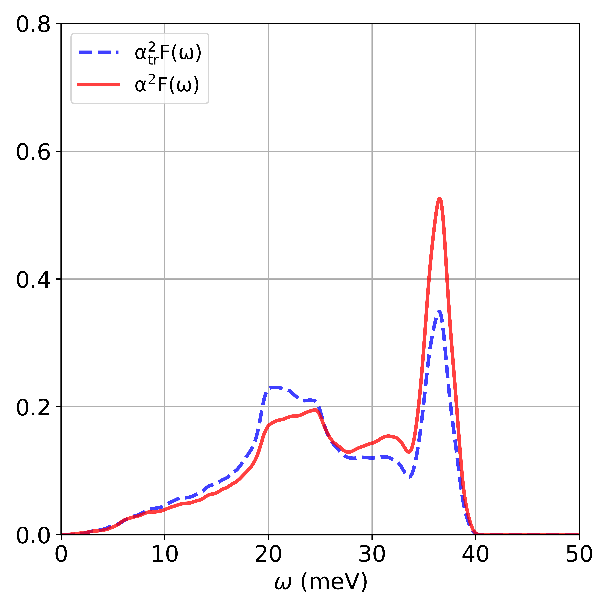
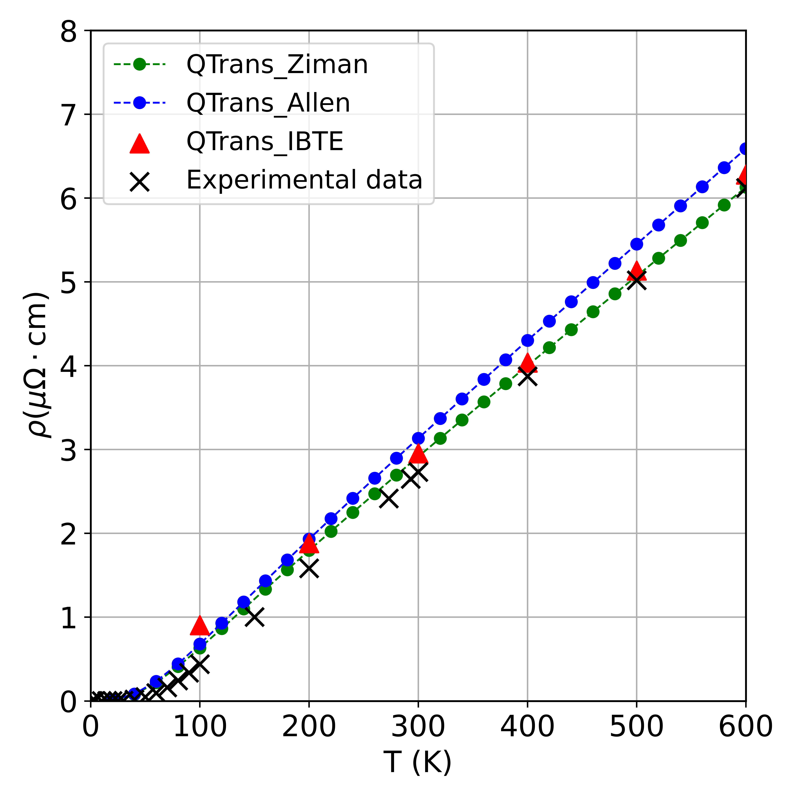

============================
Resistivity Calculation
============================

In this tutorial, we will show how to compute the phonon-limited electrical resistivity
within the momentum relaxation time approximation (MRTA)
by using the ``cal_mode: 'resistivity'`` of **QTrans**.
The relevant theories are briefly introduced in the :ref:`Resistivity <theory_resistivity>` section.

.. warning::
    The following tutorials are designed for instructional purposes.
    To save computation time, the parameter settings are simplified and the results are not fully converged.

-----------
Bulk fcc Al
-----------

In this tutorial, we use isotropic metal aluminum to introduce the calculation of electrical resistivity.
The bulk fcc aluminum tutorial is located in ``tutorials/Al/openmx/resistivity/``.
All necessary data files are available in ``tutorials/Al/openmx/data/``.
Reference outputs are provided in ``tutorials/Al/openmx/resistivity/ref/`` ,
which can be used to compare with your own results to verify that **QTrans** is running correctly.

The directory contains ``input-dense.yaml``, ``input-sparse.yaml``, and
the reference outputs in ``ref/``.

.. code-block:: none

    cd tutorials/Al/openmx/resistivity/ && ls
    input-dense.yaml  input-sparse.yaml ref/

We first use the dense gradient matrix to perform the calculation on a 16x16x16 k/q-point grid.
The smearings for both k-point and q-point integrations are set to 40 meV using ``smeark: 40`` and
``smearq: 40``. The smearing type is set to the derivative of the Fermi-Dirac function via ``gauss_type: -99``.
Here ``smeark`` sets the electronic kernel width; it is independent of
``temperature``. The transport spectrum uses Gaussian broadening for its
energy-conservation delta functions. The temperature is set to the room temperature with ``temperature: 300.0``.
Other necessary settings for the resistivity calculation are specified in the ``resistivity`` block.
The parameter ``ziman_nc`` represents the number of carriers per unit cell in the Ziman's resistivity formula.
It can be set manually.
If not set, **QTrans** will automatically estimate it based on the number of band crossings at the Fermi level,
which usually yields a good approximation.
In this case, we use the value estimated by **QTrans** by leaving it unset; both reference runs report 2.0 carriers per unit cell.

The complete ``input-dense.yaml`` is:

.. code-block:: yaml

    basic:
      cal_mode: 'resistivity'
      graph_data_path_uc: ../data/graph_data.npz
      nao_max: 14
      Ham_type: openmx
      outdir: './'

    phonon:
      supercell_matrix: [[3.0, 0.0, 0.0], [0, 3, 0], [0, 0, 3]]
      unitcell_filename: ../data/Al-pri.vasp
      force_infos_filename: ../data/FORCE_SETS

    epc:
      grad_mat_path: ../data/grad_mat.npy
      mat_info_sc_path: ../data/mat_info_sc.npy
      cell_range_cut: [2,2,2]
      phonon_frequency_cutoff: 0.5

    transport:
      k_size: [16,16,16]
      q_size: [16,16,16]
      bands_indices: '1-6'
      temperature: 300.0
      smeark: 40
      smearq: 40
      gauss_type: -99
      e_thr: 120

    resistivity:
      omega_range: [0, 50]
      omega_step: 0.05

Launch the **QTrans** calculation with:

.. code-block:: none

    mpirun -np 8 QTrans_run --config ./input-dense.yaml > dense_kq16.out

Runtime depends on the hardware and parallel configuration.
At the end of the run, you should see output like this:

.. code-block:: none

    Ziman's resistance(micro-Ohm*cm) =   9.0476e-01
    Allen's resistance(micro-Ohm*cm) =   2.8562e+00

After the calculation, **QTrans** generates a file named ``a2f.dat``, which contains
the isotropic Eliashberg spectral function
:math:`\alpha^2 F(\omega)`
and the isotropic Eliashberg transport spectral function
:math:`\alpha_{tr}^2 F(\omega)`, evaluated within the phonon energy range specified by ``omega_range``,
using a step size of ``omega_step``. Here, the range is 0--50 meV and
the step is 0.05 meV. The columns are phonon energy (meV),
:math:`\alpha_{tr}^2F(\omega)`, and :math:`\alpha^2F(\omega)`, respectively.
Preserve the dense-run spectrum before starting the sparse calculation:

.. code-block:: bash

    cp a2f.dat a2f_dense.dat

Next, we use the sparse gradient matrix to calculate the electrical resistivity.
The complete ``input-sparse.yaml`` is:

.. code-block:: yaml

    basic:
      cal_mode: 'resistivity'
      graph_data_path_uc: ../data/graph_data.npz
      nao_max: 14
      Ham_type: openmx
      outdir: './'

    advanced:
      read_sparse_grad_mat: True

    phonon:
      supercell_matrix: [[3.0, 0.0, 0.0], [0, 3, 0], [0, 0, 3]]
      unitcell_filename: ../data/Al-pri.vasp
      force_infos_filename: ../data/FORCE_SETS

    epc:
      grad_mat_path: ../data/grad_mat_sparse.npy
      mat_info_sc_path: ../data/mat_info_sc.npy
      cell_range_cut: [2,2,2]
      phonon_frequency_cutoff: 0.5

    transport:
      k_size: [16,16,16]
      q_size: [16,16,16]
      bands_indices: '1-6'
      temperature: 300.0
      smeark: 40
      smearq: 40
      gauss_type: -99
      e_thr: 120

    resistivity:
      omega_range: [0, 50]
      omega_step: 0.05

The same calculation can be performed using:

.. code-block:: none

    mpirun -np 8 QTrans_run --config ./input-sparse.yaml > sparse_kq16.out

At the end of the run, you should see output similar to the following:

.. code-block:: none

    Ziman's resistance(micro-Ohm*cm) =   9.0455e-01
    Allen's resistance(micro-Ohm*cm) =   2.8555e+00

The sparse configuration enables ``advanced.read_sparse_grad_mat: True``
and reads ``grad_mat_sparse.npy``. It yields results within approximately
0.03% of the dense calculation for both formulas. After this run, preserve
the spectrum with:

.. code-block:: bash

    cp a2f.dat a2f_sparse.dat

The reference spectra are provided as ``ref/a2f_dense.dat`` and
``ref/a2f_sparse.dat``. Both configurations write to the current directory,
so the second run replaces ``a2f.dat`` unless it is copied first.
As shown in our coarse test, Allen's formula produces resistivity values that are in better agreement with the
experimental result (2.73 :math:`\mu\Omega\cdot\text{cm}`).
The agreement of the dense and sparse calculations does not establish
convergence with respect to sampling or smearing.

We can further plot the Eliashberg spectral functions and extract the electron-phonon coupling strengths
(:math:`\lambda` and :math:`\lambda_{tr}`) using the ``a2f.dat`` file.
The converged results are shown in Figure 1.

   **Figure 1:** The converged Eliashberg and transport spectral functions of Al.

.. note::

    Both Allen's and Ziman's formulas are derived under the assumption of isotropy, and
    are therefore generally suitable only for isotropic metals.

Because :math:`\rho = \sigma^{-1}`, one can also obtain the resistivity by computing the conductivity using either the IBTE or ERTA method,
as introduced in the :ref:`Conductivity Calculation <tutorial-conductivity>` section.
This approach is not limited to isotropic metals and is applicable to all metallic systems.

At convergence, the calculated electrical resistivity results comparing with the
experimental results :cite:`desaiAluminumRho1984` at different temperatures, are shown in Figure 2.

   **Figure 2:** The converged resistivities of Al calculated with MRTA and derived from IBTE
   conductivity results using **QTrans**.
   The experimental data are taken from ref :cite:`desaiAluminumRho1984`.
