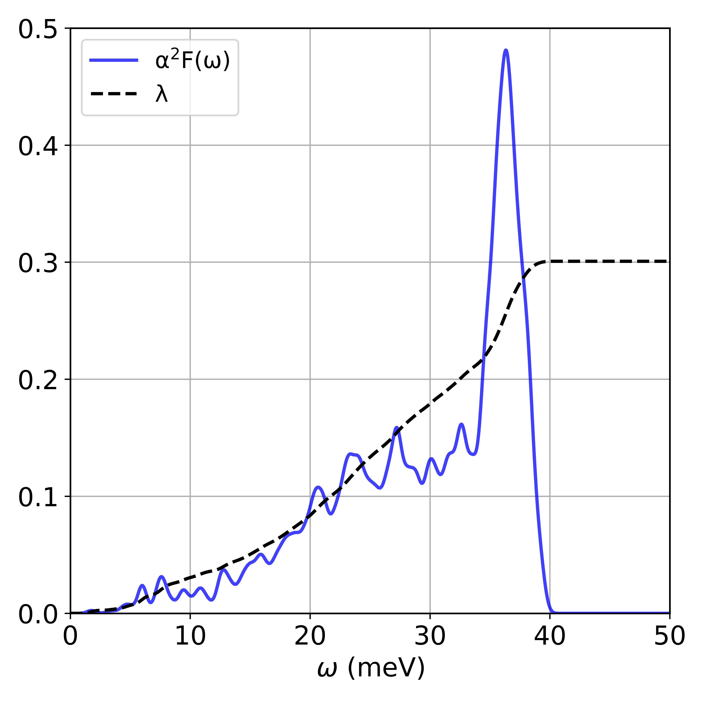

.. _tutorial-superconductivity:

================================
Superconductivity Calculation
================================

In this tutorial, we will show how to compute the superconductivity temperature
using the ``cal_mode: 'superconductivity'`` of **QTrans**.
The relevant theories are briefly introduced in the :ref:`Superconductivity <theory_superconductivity>` section.

.. warning::
    The following tutorials are designed for instructional purposes. 
    To save computation time, the parameter settings are simplified and the results are not fully converged.

--------------------------------------------
Superconductivity of bulk aluminum
--------------------------------------------

Here, we use **QTrans** to evaluate the superconducting properties of fcc aluminum.
The bulk fcc aluminum tutorial is located in ``tutorials/Al/superconductivity/``. 
All necessary data files are available in ``tutorials/Al/data/``. 
Reference outputs are provided in ``tutorials/Al/superconductivity/ref/`` , 
which can be used to compare with your own results to verify that **QTrans** is running correctly.

Enter into the directory, and there would be a yaml file ``input-sc.yaml`` and 
the ``ref/`` folder.

.. code-block:: none

    [user]$ cd tutorials/Al/superconductivity/ && ls
    input-sc.yaml ref/

We perform the calculation on a 30x30x30 k-point and q-point grid using the dense gradient matrix.
In the file ``input-sc.yaml``, we specify a range of effective Coulomb potentials :math:`\mu^*`
form 0.05 to 0.25 with a step size of 0.01 by setting ``mius: [0.05, 0.25, 0.01]``.
The phonon energy range is set from 0 to 50 meV with a step size of 0.01 meV by specifying
``omega_range: [0, 50]`` and ``omega_step: 0.01`` in the ``superconductivity`` block, 
in order to evaluate the Eliashberg spectral function
:math:`\alpha^2 F(\omega)`.

Launch the **QTrans** calculation with:

.. code-block:: none

    [user]$ mpirun -np 8 QTrans_run --config ./input-sc.yaml > kq30_sc.out

The calculation should take about 7 min to complete on an 8-CPU machine.
At the end of the run, you should see output similar to the following:

.. code-block:: none
    
    ...
    Lambda = 0.30082756651689796
    Omega log = 22.70248034642614 meV
    mu        Tc (K)
    0.0500    8.103276e-01
    0.0600    6.066763e-01
    0.0700    4.401043e-01
    0.0800    3.076724e-01
    0.0900    2.058774e-01
    0.1000    1.307377e-01
    0.1100    7.793192e-02
    ...

This output indicates that the electron-phonon coupling strength :math:`\lambda` is 0.30, and the 
logarithmic average of the phonon frequencies :math:`\omega_{\text{log}}` is 22.70 meV.
The corresponding critical temperatures (Tc) for each value of the effective Coulomb potential
:math:`\mu^*` are also provided. The highest Tc
In this example, the highest calculated Tc of 0.81 K is close to the experimental value of 1.2 K :cite:`cochranAluminumTc1958`.

**QTrans** also generates the Eliashberg spectral function :math:`\alpha^2 F(\omega)` 
and saves the result in a file named ``a2f.dat`` in the current directory, 
with the following format:

.. code-block:: none
    
    #omega (meV)    a2f
    ...
    24.1200        0.1329
    24.1300        0.1327
    24.1400        0.1325
    24.1500        0.1323
    24.1600        0.1321
    24.1700        0.1319
    24.1800        0.1316
    ...

The first column represents the phonon frequency (in meV), and the second column contains the corresponding values of :math:`\alpha^2 F(\omega)`.
Using the ``a2f.dat`` file, you can plot the Eliashberg spectral function :math:`\alpha^2 F(\omega)`
along with the integrated electron-phonon coupling strength :math:`\lambda`, as shown in Figure 1.

   **Figure 1:**  Calculated isotropic Eliashberg spectral function :math:`\alpha^2 F(\omega)` of Al
   (blue solid line) and integrated electron-phonon coupling strength :math:`\lambda` (black dashed line).